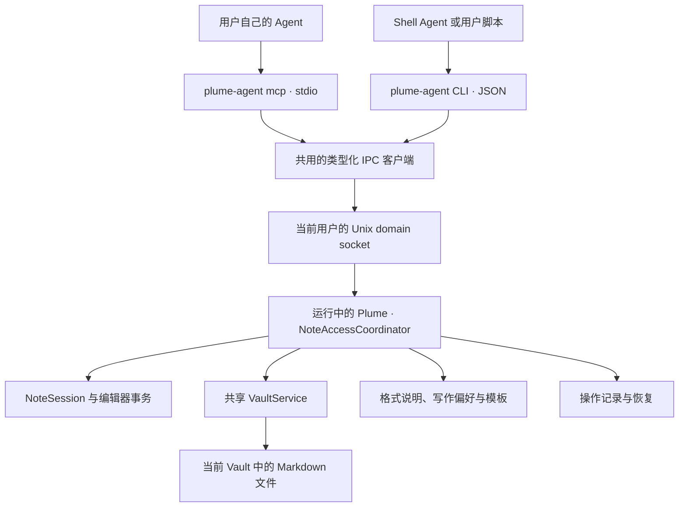

# Plume 本地 Agent 接入方案

| 项 | 内容 |
|---|---|
| 状态 | v1 设计草案，尚未实施 |
| 日期 | 2026-10-13 |
| 代码基线 | `99fd7af` |
| 目标 | 用户在自己的 Agent 中搜索、读取笔记，并按 Plume 格式和个人习惯创建、修改笔记 |
| 首版范围 | 本地 stdio MCP、共用逻辑的 CLI、写作上下文、创建、局部修改、编辑会话协调、版本检查、幂等与结果查询 |
| 后续范围 | 当前选区、未落盘草稿、更多修改方式、更多 MCP transport、远程 Agent 接入 |

本文定义拟新增能力，接口名、文件布局和数量限制均为设计约定，不表示当前版本已经支持。现有行为以列出的仓库文件为依据。实施分阶段进行，但完整首版必须包含 `create_note` 和 `modify_note`。

## 1. 目标与关键决定

### 1.1 用户场景

用户在自己的 Agent 中完成讨论，希望自然地把结果留在 Plume：

> 把刚才的讨论按我的习惯整理进 Plume；有相关笔记就更新，没有就新建。

期望流程：获取写作上下文 → 搜索相关笔记 → 读取目标或范例 → Agent 整理 Markdown → 创建或修改 → 返回具体笔记与修改结果。

另一个常见场景是持续更新：

> 把项目笔记里的方案改为刚才确定的版本，补上两条待办，其他内容保留。

这要求修改支持局部替换，并与用户同时编辑、自动保存和同步带来的变化协调。

### 1.2 决策摘要

| 决定 | 理由 |
|---|---|
| 官方 stdio MCP 为主要入口，CLI 复用相同业务协议 | 接入支持本地 MCP 的 Agent，也覆盖具有 Shell 能力的 Agent |
| 随 Plume.app 分发原生辅助程序 | 安装应用即可使用，无需 Node、Python、源码或第二套手动安装 |
| Vault 相关 API 经本机 IPC 进入运行中的 Plume | 只有应用同时知道磁盘、编辑缓冲区、保存任务和当前 Vault |
| 应用是 API 写入的唯一执行者 | 避免不同 MCP 子进程各自写文件、竞争命名和绕过编辑会话 |
| 首版包含创建与修改 | 满足讨论结果落入笔记的完整场景 |
| Agent 负责生成内容，Plume 提供写作上下文并执行保存 | 用户选择自己的模型；Plume 无需模型账号、模型 SDK 或云端生成服务 |
| 修改要求版本，默认局部修改 | 保留用户原文与结构，发现并发变化后重新读取 |
| 用户偏好与模板显式维护 | 先让行为可解释、可编辑，不依赖对整个 Vault 的隐式推断 |
| 本地连接默认关闭，提供只读和创建及修改两档 | 用户明确选择 API 开放的能力，已授权的写入无需每次弹窗 |
| 保存结果与同步结果分开 | 成功意味着本机笔记保存完成，不等同于已上传 iCloud 或 Git remote |

首版为了统一版本与权限语义，Vault 读取也走应用。应用退出时由辅助程序直接读取文件可以作为将来的只读优化；首版遇到应用未运行时启动应用，再完成请求。

### 1.3 首版边界

- 当前配置的一个 Vault，沿用现有平铺 `.md` 文件模型。
- 创建普通笔记；读取并修改有文件身份的笔记，包括正在编辑的笔记。
- 不提供删除、移动 Vault、修改设置、执行命令、访问任意文件或 Git 操作工具。
- 不提供未落盘草稿、当前选区、批量跨笔记事务或模糊自动合并。
- 不将笔记格式改为数据库、强制 front matter 或隐藏块 ID。
- 用户仍可直接通过文件系统访问自己的 Markdown；API 权限不替代操作系统文件权限。

## 2. 现有实现与可复用边界

| 仓库位置 | 当前能力 | 设计中的用法与缺口 |
|---|---|---|
| [Settings.swift](../../Sources/PlumeKit/Persistence/Settings.swift)、[SettingsStore.swift](../../Sources/PlumeKit/Persistence/SettingsStore.swift) | `vaultPath` 指定当前 Vault；设置支持手动编辑与实时重载 | 应用负责发现 Vault；辅助程序不创建第二份 Vault 配置 |
| [BuildProfile.swift](../../Sources/PlumeKit/Support/BuildProfile.swift) | 正式版与开发版的 bundle、配置目录、Vault 隔离 | IPC、凭据、写作文件和操作记录也必须隔离 |
| [NoteIndex.swift](../../Sources/PlumeKit/Notes/NoteIndex.swift)、[NoteSearch.swift](../../Sources/PlumeKit/Notes/NoteSearch.swift) | 增量索引；标题与文件名模糊搜索，正文按字面搜索 | 复用算法，新增程序用 DTO；不直接暴露 Switcher 的本地化 UI 行 |
| [MarkdownDocument.swift](../../Sources/PlumeKit/Notes/MarkdownDocument.swift)、[NoteFilename.swift](../../Sources/PlumeKit/Notes/NoteFilename.swift) | 第一条非空行作为标题；文件名生成与重名处理；尾换行规范化 | 创建沿用同一实现；修改不重新生成文件名 |
| [VaultService.swift](../../Sources/PlumeKit/Vault/VaultService.swift) | 同一进程内串行执行 Vault I/O；维护索引；下载独立于写入队列 | API 复用同一个服务实例；串行队列不能约束应用外的文件写入 |
| [VaultIO.swift](../../Sources/PlumeKit/Vault/VaultIO.swift) | 文件协调、原子写入、磁盘原始字节 hash、iCloud 可用性检查、冲突副本 | 需增加 API 用严格更新语义；现有 `expectedHash: nil` 无条件写入和缺失文件重建行为不能直接用来修改 |
| [NoteSession.swift](../../Sources/PlumeKit/Session/NoteSession.swift)、[NoteSession+External.swift](../../Sources/PlumeKit/Session/NoteSession+External.swift) | 500 ms 自动保存、草稿物化、外部变化协调、创建初期标题跟随改名 | 增加 Agent 操作接缝和异步保存完成通知；读取不得强制物化草稿 |
| [protocol.ts](../../Editor/src/bridge/protocol.ts)、[host.ts](../../Editor/src/bridge/host.ts) | Swift ⇄ Web 桥接；`loadNote` 替换全文并清空撤销历史 | 新增带版本检查的局部编辑事务与确认消息；不能用 `loadNote` 模拟 Agent 修改 |
| [dialect.ts](../../Editor/src/markdown/dialect.ts)、[decorate.ts](../../Editor/src/markdown/decorate.ts) | Plume Markdown 解析与显示规则 | 写作说明需与这些规则保持一致，不能笼统承诺完整 GFM 的显示效果 |

特别注意：`NoteIndex` 可收到编辑缓冲区内容，不等于持久化快照；API 的 `read_note` 必须明确返回内容来源与版本，不能仅从索引拿正文。`VaultService.drain()` 是退出时的有界等待，也不适合作为常规 API 成功确认机制。

## 3. 接入架构与生命周期

### 3.1 调用关系



辅助程序不写 Vault、`state.json` 或 `settings.json`。所有笔记变更由应用调度，使用现有的 Vault 服务和编辑会话。

### 3.2 辅助程序与安装

拟新增 SwiftPM 可执行 product `plume-agent`，随 App 分发到 `Plume.app/Contents/MacOS/plume-agent`。同一程序提供 `mcp` 子命令和普通 CLI，不维护两套笔记业务逻辑。

- 设置中的连接配置使用当前 App 的实际绝对路径；支持 Applications 之外的安装位置。
- 可选的用户级 CLI 链接只是便利功能，不依赖 `/usr/local/bin`、Homebrew 前缀或管理员权限。
- 移动 App 后重新复制连接配置；更新应用时重新启动 Agent 的 MCP 子进程。
- 正式版和开发版 helper 根据所属 App 的 `Info.plist` 解析 profile，不能依赖 helper 自己的 `Bundle.main.bundleIdentifier`，也不能让环境变量切换到另一 profile。
- helper 只启动自己所属的 App；不根据显示名称搜索并启动其他安装副本。
- helper 不修改当前进程的用户主目录或替换操作系统级环境变量。

构建脚本需构建并拷贝 helper，覆盖 arm64/x86_64 产物；签名时先签 helper，再签 App，继续验证和公证完整 bundle。现有 [build-app.sh](../../Scripts/build-app.sh) 的单一可执行文件假设及预编译产物入口都要同步调整。

### 3.3 IPC 与应用启动

- 使用 Unix domain socket，无 TCP 端口，无远程监听。
- socket 位于当前用户专用、名称较短的临时运行目录；目录权限 `0700`，socket 权限 `0600`。不要把长的 Application Support 路径直接用作 socket 路径。
- 每个用户、每个 profile 只有一个主应用 owner；由进程生命周期锁保护共享配置、journal 和 API 写入。相同 profile 的多个安装副本不能各自启动一个 writer。
- 按 profile 区分运行目录；包含安装实例标识，helper 与 App 在握手中核对实例、profile、IPC 主版本及应用版本。已有 owner 属于另一安装副本时返回 `APP_INSTANCE_MISMATCH`，提示使用正在运行的安装副本生成配置，不另启 writer。正式版与 Dev 可以各自运行。
- 运行目录定位规则需确定且可测试；验证 owner、类型及符号链接，避免连接到同名替代文件。
- 应用未运行时，通过 LaunchServices 非激活启动所属 App，等待有界的 ready 握手。正常请求不 summon Panel，不抢焦点，不自动打开新建笔记。
- 已有应用尚未就绪、IPC 不兼容、Vault 缺失、首次设置未完成或调用超时时返回明确错误，不退回 helper 直接写文件。
- socket 由应用拥有；清理陈旧 socket 前检查没有活跃 owner。多个 MCP 子进程连接同一应用。
- 正常关闭停止接受新写入，完成或记录正在执行的操作；不能只断开连接就遗忘写入结果。

建议初始限制：本地 ready 等待 5 秒、普通请求 10 秒。下载使用独立的较长等待与取消机制，不占用 Vault 写入队列。具体数值是首版默认值，实施时通过冷启动和 iCloud 实测校准。

### 3.4 MCP 与 CLI 协议

MCP adapter 优先采用维护中的 Swift MCP SDK，限定在辅助程序 target；接入实现前验证 stdio、初始化/能力协商、tools schema、错误与取消处理、macOS 14、CLI Tools 构建和许可证。若 SDK 引入不适合本项目的依赖，先记录替代方案与代价，再决定；不默认自行维护完整 MCP 协议栈。

IPC 使用有大小上限的长度前缀 JSON 消息，强类型解码。未知方法、类型错误与未知主版本明确拒绝。外部 JSON 不能复用编辑器桥接中面向 UI 的宽松解码。

MCP 与 CLI 共用领域请求和结果：

- MCP 通过协商后的标准工具结果返回结构化数据与简短文本摘要；业务失败使用工具错误结果，保留领域错误码。JSON-RPC 层错误仅用于协议问题。
- CLI 默认 `--json` 可用；JSON 输出与业务结果一致，诊断只写 stderr。成功退出码为 0，业务失败为 1，命令用法错误为 2。
- stdio MCP 的 stdout 只输出协议消息，日志、启动信息和 Swift 诊断进入 stderr。
- 日志不记录笔记正文、模板内容或连接凭据。

## 4. 工具与内容版本

### 4.1 首版工具

| 工具 | 主要输入 | 结果与约定 |
|---|---|---|
| `get_writing_context` | 可选 `target`、`template_id`、用户明确选择的 `example_refs` | 格式说明、写作偏好、模板和有限范例；说明来源与版本 |
| `list_notes` | 可选 `cursor`、`limit` | 分页元数据，包含 `note_ref`、标题、修改时间、可用性；不返回正文 |
| `search_notes` | `query`、可选 `cursor`、`limit` | 排序结果与匹配片段；说明标题模糊、正文按字面搜索 |
| `read_note` | `note_ref`、可选 `download` | Markdown、版本、来源、未保存状态与格式警告 |
| `create_note` | `markdown`、`request_id` | 已保存文件的引用、实际文件名、版本与操作结果 |
| `modify_note` | `note_ref`、`expected_version`、`changes`、`request_id` | 局部修改后的引用、版本与操作结果 |
| `get_operation` | `request_id` | 查询超时、断连或恢复中的写入；不暴露正文 |

`get_operation` 是为可靠写入增加的辅助工具。权限不足时写工具不出现在 `tools/list` 中，服务端仍需逐请求校验权限。权限变化后按客户端协商能力发送工具列表变更通知；即使客户端缓存旧列表，应用也拒绝未授权调用。

所有返回结果包含 `api_version`。元数据中的时间使用 ISO 8601，不返回 Switcher 的“刚刚”“今天”等本地化显示字符串。

### 4.2 笔记引用与 Vault 变化

`note_ref` 是不透明的引用，绑定 profile、Vault 身份与该文件名，不接受任意绝对路径。内部文件名可作为返回的可读字段，不作为客户端自由拼接路径的入口。

- 不往笔记写 UUID 或 front matter；不改变现有文件身份模型。
- 改标题不会改变已有笔记文件名。Agent 创建的笔记以完成的正文一次命名，不进入“刚创建、跟随标题变化”的编辑阶段。
- 用户手动改名或外部删除后，旧引用可能失效；返回 `NOTE_NOT_FOUND` 并重新搜索，不用猜测内容相同的文件就是原文件。
- API 暴露处于标题跟随阶段的已有笔记前，应通过会话结束其自动改名状态，让返回的引用保持稳定；这不等于保存或重写内容。
- 切换、移动 Vault 时暂停新写入。完成或恢复已经准备的操作后再切换，增加 Vault epoch，使旧引用与版本不能写入新 Vault。
- 队列任务捕获原 Vault 身份，执行前再次核对；不能在执行时只读取可变的全局 `vaultPath`。
- 同一路径的文件被替换仍需重新做版本检查；首版不承诺任意外部 rename 的持久追踪。

路径边界在应用端实现：只处理 Vault 根目录下的普通、非隐藏 `.md` 文件；拒绝路径分隔符、`..`、控制字符、符号链接、目录和边界外文件。复用 `NoteFilename.isNoteFile` 前补充边界验证，因为它目前只检查文件扩展名与隐藏文件。预检查不能替代 I/O 边界检查；在协调 accessor 中再次核对文件类型与目标，读取使用不跟随符号链接的打开方式。

### 4.3 读取已保存内容与编辑内容

`read_note` 默认读取应用当前有效的内容：笔记正在编辑时获取编辑器确认过的快照，否则读取磁盘。

```json
{
  "api_version": 1,
  "note_ref": "note:opaque-reference",
  "filename": "2026-10-13-1430-agent接入.md",
  "title": "Agent 接入",
  "markdown": "# Agent 接入\n\n## 待办\n\n- [ ] 完成接口设计\n",
  "version": "version:opaque-snapshot",
  "source": "editor",
  "has_unsaved_changes": true,
  "availability": "available",
  "warnings": []
}
```

`version` 与 `note_ref` 都由服务端生成。上述字符串只是示例。对调用者，版本是相等比较用的 token，不是时间戳，也不能把正文 hash 自行拼成版本。

服务端快照至少记录：Vault epoch、文件身份、磁盘原始字节 hash、返回正文的 hash、编辑会话身份及递增 revision。内部原始字节 hash 与返回文本的 hash 分开，因为加载会规范化尾换行。

编辑器快照需要通过桥接 barrier 确认最新文档和 revision，不能假设 Swift 最近收到的 `edited` 消息已经覆盖当前屏幕内容。读取不保存、不清空撤销历史、不改变光标，也不物化草稿；第 4.2 节的自动命名冻结是唯一显式的会话身份调整。

本应用随后自动保存完全相同的正文、且编辑 revision 未变化时，可根据本应用写入完成证据推进该 token 的磁盘 baseline，让单纯的自动保存不会使修改必然冲突。不能只凭“磁盘内容看起来相同”容许未知的外部变更。

版本在应用重启、Vault 切换、文件改名或快照过期后失效，调用方重新读取。建议快照缓存有效期为 10 分钟，返回值提供 `version_expires_at`；该缓存上限与驱逐策略由同一处常量定义。操作查询返回的是历史保存结果，其 version 也可能失效，继续修改前应重新读取。

编辑器与磁盘间的 CRLF/LF 转换必须显式处理：快照保留返回文本与磁盘原文之间的行结束映射。未修改的磁盘片段保留原文，新片段使用请求中的文本；不能因为 CodeMirror 返回 LF 就在 Agent 局部修改时顺便重写全篇 CRLF。

### 4.4 分页、下载与上限

- `list_notes` 默认按修改时间倒序，文件名作稳定的次级排序。`search_notes` 复用相关性排序。
- cursor 绑定查询与短期结果快照；过期返回 `CURSOR_EXPIRED`，不承诺长期遍历时完全冻结 Vault。
- iCloud 未下载文件列出 `availability: "evicted"`；搜索返回覆盖范围，明确哪些文件正文未参与检索。
- `read_note` 默认不触发下载，返回 `NOTE_NOT_AVAILABLE`；`download: true` 表示调用者允许取回该篇内容。使用独立下载队列并报告进度，不自动下载整个 Vault。
- 保存本地文件后继续走已有 iCloud/Git 同步流程；成功结果标记 `saved_locally: true`，不等待远端上传，不触发强制 Git push。

建议初始上限：列表每页默认 20、最多 100；单篇正文 1 MiB UTF-8；单次修改最多 32 项；IPC 消息最多 4 MiB；写作范例最多 3 篇，总输出正文最多 32 KiB。超限返回明确错误，不能截断正文后继续修改。已有较大笔记仍保留在 Vault，API 返回 `CONTENT_TOO_LARGE`。这些限制需契约测试并在接入说明中公开。

## 5. 写作上下文与 Plume 格式

### 5.1 三类信息

| 类型 | 管理者 | 保存位置与角色 |
|---|---|---|
| 格式能力说明 | Plume 随版本维护 | App 资源中的机器可读能力描述与写作说明；描述实际解析和显示效果 |
| 写作偏好 | 用户 | Application Support 下的普通 UTF-8 Markdown 文件；设置中可编辑、定位 |
| 模板 | 用户 | 同目录下的模板文件夹；按用途提供结构，Agent 根据本次对话填写 |

拟定存储：

```text
~/Library/Application Support/Plume/
  Agent/
    preferences.md
    Templates/
      meeting.md
      discussion.md
      project.md
    Operations/
```

开发版对应 `Plume (Debug)`。这些是机器上的接入配置，不进入 Vault、不成为普通笔记、不默认加入笔记 Git 同步。用户可自行同步这些普通文件；首版不增加隐式同步机制。

首次用户启用接入时可生成偏好与模板示例；不覆盖用户编辑或删除过的示例。文件缺失表示没有对应偏好，不擅自从其他笔记推断。Agent 没有通过笔记工具修改偏好、模板或连接权限的能力。`template_id` 只解析 Templates 中已登记的普通文件，拒绝路径穿越与符号链接；偏好和模板同样检查 UTF-8、大小和权限，超限或格式错误返回上下文警告，不返回不完整规则冒充完整偏好。

### 5.2 优先级与输出结构

建议 Agent 按以下顺序处理：

1. 本次用户明确要求。
2. 用户保存的写作偏好及本次指定模板。
3. 目标笔记或明确选择的范例所体现的既有结构。
4. Plume 提供的默认建议。

格式能力是显示约束，不能因风格偏好而声称一种未支持的语法可以渲染。用户明确要求保存原始 Markdown 时允许原样保留，并返回格式提示，不强行改写。

`get_writing_context` 返回 `format_version`、`preferences_version`、模板版本、各段来源、建议优先级及警告。版本是帮助 Agent 判断是否需要重读上下文的信息，不强制让偏好变化阻止已经生成的内容保存。

- 编辑目标时可以附带该目标的短片段与结构提示；版本与正文仍以 `read_note` 为准。
- 范例仅限用户选择或 Agent 基于明确任务搜索到的笔记，不自动遍历并返回全部 Vault。
- 截断只适用于风格范例，必须带 `truncated`；不能把截断范例当作完整修改依据。
- 模板和笔记内容作为数据返回，明确标注来源。笔记正文中的指令不视为连接权限或用户授权。
- 接入帮助提醒用户：内容由其 Agent 处理；使用云端模型的 Agent 时，所读内容可能发送给该模型服务。Plume 本身不增加模型网络请求。

### 5.3 推荐生成规则

随版本维护的说明至少覆盖：

- 笔记为 UTF-8 Markdown；标题来自第一条非空行，不必另传一个可能与正文冲突的标题字段。
- 新建默认建议以 `# 标题` 开始；编辑沿用已有标题习惯。
- 支持的常用显示包括标题、段落、列表、无序任务列表、引用、代码块、强调、删除线、链接，以及高亮与下划线。
- 块标记需要空格，例如 `# 标题`、`- 项目`、`> 引用`。
- 任务用 `- [ ] 文本`、`- [x] 文本`；有序列表中的 `[ ]` 保留为普通文本。
- 列表项内的标题、规则线、引用、代码块、表格、HTML，以及引用内的标题、代码块、表格、HTML，不按通常 CommonMark/GFM 的嵌套方式解释。复杂块内容放到顶层。
- 当前表格不提供专门的表格显示，图片保留 Markdown 原文；不要把语法可解析等同于拥有完整可视化展示。
- 不承诺 Mermaid、数学公式、脚注、Wiki 链接或 YAML 元数据的专门显示。默认模板不生成这些结构，也不在首行放 front matter，以免影响标题识别。
- 生成来源、日期、参与者、待办负责人等仅在偏好、模板或用户要求时加入；不自动附加整段聊天记录或“由 AI 生成”尾注。

### 5.4 校验与规范化

服务端严格校验编码、大小、路径、请求结构和修改前提。正文不为空的创建可以包括没有可提取标题的内容，此时沿用现有 `untitled` 命名；纯空白创建拒绝。

保存只复用现有尾换行规范化；不重排列表、不重写标题、不插入元数据，不改变正文中间的 CRLF 或用户措辞。`modify_note` 也不改变标题对应的文件名。

首版的格式检查是明确规则与有限警告，不复制一套 Swift Markdown parser 来宣称完整语法校验。需要语法树的警告复用实际编辑器 parser，并以同一组夹具验证格式能力说明；工具声明的渲染能力变更必须连同实际 WKWebView 表现一起更新。

## 6. 创建与修改契约

### 6.1 创建

```json
{
  "markdown": "# Agent 接入讨论\n\n## 结论\n\n采用本地 MCP。\n\n## 待办\n\n- [ ] 实现创建和局部修改\n",
  "request_id": "7ac18057-b3bc-4b43-8146-e77aa657ac19"
}
```

应用在共享队列中生成并预留唯一文件名，以当前 Vault 为目标，调用一次创建。命名来自正文，不接受任意 filename 或 path。为操作恢复增加可追踪的创建入口，但命名算法与 UI 创建共用。预留记录只能约束本应用；最终创建需保证目标原先不存在，使用排他创建/不覆盖的发布方式。外部进程占用预留路径时明确冲突，不能用现有无条件写入覆盖它。

成功返回 `operation_id`、`note_ref`、`filename`、`version`、`saved_locally: true`、`changed: true` 及格式警告。应用不自动 summon 新笔记；后续用户可以从 Switcher 找到它。

### 6.2 局部修改

```json
{
  "note_ref": "note:opaque-reference",
  "expected_version": "version:opaque-snapshot",
  "changes": [
    {
      "kind": "replace",
      "old_text": "采用 HTTP 服务。",
      "new_text": "采用本地 stdio MCP，并通过 IPC 交给 Plume 保存。"
    },
    {
      "kind": "append",
      "text": "\n\n## 待办\n\n- [ ] 完成桥接协议\n"
    }
  ],
  "request_id": "3356bbfe-946b-45c0-b119-54a89913d171"
}
```

首版只提供两种操作：

| 操作 | 前提 |
|---|---|
| `replace` | 非空 `old_text` 在读取快照中唯一匹配；`new_text` 可为空，表示删除这段内容 |
| `append` | 在同一个读取快照的末尾追加指定原文；每个请求最多一项 |

所有替换匹配同一份原始快照，不逐项匹配前一项的输出；区间不得重叠。正文插入可用“替换唯一锚点为锚点加新内容”表达。先验证所有区间，再一次生成候选正文，一个请求整体提交，不出现前两项成功、第三项失败。

追加不自动猜测分节、换行和来源格式，Agent 负责提供需要的间隔；最后按 Plume 规则规范化尾换行。替换使用返回正文的精确文本，不忽略大小写、不模糊匹配、不自动匹配第一个相似段落。

不公开字符 offset，避免模型计数错误、Unicode 与 UTF-16 单位混淆。内部转换为编辑器 change ranges 时由程序计算并通过 emoji、组合字符及 CRLF 测试。

全文重写首版不单独提供模式；必要时可用整篇读取正文作唯一 `old_text`，仍受版本与大小限制。后续有明确需求再增加带显式语义的全文替换。修改为空文本会造成隐式删除整篇内容，因此首版拒绝纯空白的最终正文。

### 6.3 失败与无变化

- 匹配不到、出现多次、区间重叠或候选正文不合法：返回具体错误，文件和编辑器都不变。
- 版本失效：返回 `VERSION_CONFLICT` 或 `VERSION_EXPIRED`，不自动重读后把原修改盲目重放。
- 候选正文与有效内容相同：返回 `changed: false`。若原快照有未保存内容，仍要按本次写入请求完成保存，才可以返回 `saved_locally: true`。
- 文件已删除：返回 `NOTE_NOT_FOUND`，不能因为已有 `expectedHash` 就重建原路径。
- 冲突不自动创建一篇新笔记再报告修改成功；需要另存时由用户或 Agent 明确调用创建。

## 7. 编辑、文件与同步的协调

### 7.1 修改前的版本检查

修改必须同时检查：

1. profile、Vault 身份与 epoch 一致，文件仍存在且可用。
2. 磁盘原始字节 hash 与读取快照一致，或对应第 4.3 节中可证明的同内容自动保存转换。
3. 若笔记正在编辑，编辑器 session 与 revision 也一致。
4. 没有尚未结算的写入、创建、改名或 Vault 迁移正在改变目标。

`NOTE_BUSY` 可用于暂时无法形成一致快照的状态；返回可重试标志，但版本变化后必须重新读取。不要用阻塞主线程的 `drain()` 或同步等待绕过状态协调。

仅磁盘 hash 匹配不够：读完后的新输入可能尚未落盘；仅编辑器内容匹配也不够：外部工具或同步可能已经改变文件。

### 7.2 已打开笔记

需要新增条件编辑事务，而非调用 `loadNote`：

1. 取得明确的编辑器快照，生成候选 changes，并在会话中准备操作。
2. 在准备与真正应用之间再次校验磁盘和编辑器；Web 端在同一个 JavaScript turn 内比较 session/revision 并 dispatch，不能把一次早先的版本查询当作提交保证。
3. 将全部 changes 作为一个独立的 CodeMirror history event 应用，隔离此前和此后的用户输入。映射 selection 与光标，保留此前撤销历史，不抢焦点、不强制滚动。
4. Web 端确认实际应用后的 revision 与正文；原生会话更新 buffer 和命名状态。走操作专用保存路径，保存确认的候选快照，不依赖 watcher 发现本进程变更。
5. 保存成功后推进 baseline、更新索引与元数据，记下操作结果。用户随后输入的内容通过同一写入 gate 顺序保存。

在编辑事务应用前发现前提检查失败，编辑器和文件不变。取消仅在进入持久化准备前保证未应用；此后按第 8.4 节结算操作。操作应用后用户可继续输入，不在磁盘 I/O 期间长期禁用键盘。

磁盘保存和 Web 编辑事务不是单一原子事务。应用后的 I/O 失败或外部写入冲突必须明确返回 `SAVE_FAILED` 或 `SAVE_CONFLICT`，带 `buffer_applied: true`、`saved_locally: false`；保留编辑缓冲区与恢复记录，并在 Panel 显示保存问题。不能把后续用户输入回滚掉，也不能将“已更新界面”报告为已保存。

若保存失败但候选正文已在缓冲区，重试同一 `request_id` 继续查询或恢复该操作，不能再次应用同一追加。UI 正常自动保存也要参与操作结果结算，防止内容已被后续保存而操作记录仍声称未应用。若现有外部冲突处理最终把缓冲区保留到 sibling，操作记录必须明确实际保存位置与原目标未更新，不能标记为目标修改成功。

事务应用后，用户切换笔记、隐藏 Panel 或退出时，操作仍持有固定目标和候选快照，按同一 gate 完成保存与结算，不因 `currentFilename` 已改变而遗漏。

在尚未应用编辑器事务时发现版本冲突才使用 `VERSION_CONFLICT`，并保证没有本次操作的内容变更。应用后的失败使用独立错误，避免客户端误以为可以直接重新提交。

未落盘草稿首版不获得 `note_ref`；Agent 新建笔记与用户当前草稿独立，不覆盖或强制保存草稿。

### 7.3 未打开笔记

在共享 Vault 队列中使用新的严格更新方法：

- 检查已有文件，要求非空 `expectedHash`，拒绝 missing/evicted。
- 在 `NSFileCoordinator` accessor 内比较最新 hash，再原子写入。
- hash 不匹配时返回冲突，不写 sibling，不覆盖、不重建。
- 写入后更新索引，通知菜单和 Switcher；用户后来打开的是已保存版本。

笔记在准备过程中被用户打开或关闭时重新核对会话，必要时重新准备，不能继续按原来“没有编辑器”的假设提交。

### 7.4 应用外写入的边界

`NSFileCoordinator` 能协调配合该协议的进程，不能阻止任意 Shell 重定向、同步工具或 Git 在检查和替换之间写入。不能宣称 API 与所有外部进程具备全局事务隔离。

- 串行化应用内 API、UI 保存和改名；API 严格 hash 检查在协调区间内完成。
- Git cycle 的工作树修改与 API 提交通过显式 gate 协调。网络 fetch 不长期占用提交 gate，commit/merge 等会接触工作树的阶段必须有明确排他关系。
- FSEvents 与现有外部协调继续处理同步到来的变化；发现不一致时结束操作并报告实际状态。
- 提交前在操作记录中保留修改前后快照；异常时可以恢复，但不承诺替不受协调的其他进程保留所有中间版本。
- 返回成功后发生的新修改是新的内容版本；成功只证明本次本地保存完成，不承诺后续文件一直保持不变。

### 7.5 撤销与恢复

正在显示的笔记中，Agent 修改与用户输入之间有 history boundary，`⌘Z` 可以独立撤销本次 Agent 操作。撤销产生新的内容版本，并作为正常编辑保存，不删除操作历史。

未打开的笔记没有有效的编辑器撤销栈；因此操作记录保留受保护的修改前快照，首版设置中的最近写入可提供“查看结果”和“恢复修改前版本”。恢复要求目标仍与本次操作结果一致；若后来已经变化，则拒绝覆盖，让用户显式另存恢复内容。

恢复内容通过同一写入路径，产生新的操作，而不是倒置 journal 状态。暂定完成操作的恢复快照保留 7 天；用户清除记录也清除恢复快照。恢复是首版写入的可恢复性要求，不依赖未启用的 Git 同步。

## 8. 幂等、超时与崩溃恢复

### 8.1 请求身份

每次创建或修改要求调用者生成 UUID `request_id`，重试同一操作沿用该 ID。JSON-RPC request id 不能代替它，因为连接重建和工具重试可能改变传输层 ID。

去重身份绑定 profile、连接授权代际与 `request_id`，在绑定当前 Vault 或校验版本有效期前先查操作记录。Vault 身份在第一次接受请求时固定并写入记录；即使之后切换 Vault，同一 ID 的创建重试也只能返回原操作，不会在新 Vault 再创建一篇。`get_operation` 按授权代际与 ID 查询，包括已不再是当前 Vault 的历史操作。

输入摘要覆盖固定的 Vault、目标、expected version 与类型化请求的确定性 JSON 序列化。精确匹配用的 `old_text`、替换和追加文本保留原文，不为了计算摘要而 trim 或改写；创建正文可按既有尾换行规则统一。

- 同一 ID 与同一输入：返回已有状态或结果，不再次创建、替换或追加。
- 同一 ID 与不同输入：`REQUEST_ID_REUSED`，拒绝执行。
- 同一 ID 的并发调用：加入同一进行中的操作，不能各自写入。
- 冲突后重新读取、重新生成的修改是新操作，应使用新 ID。

### 8.2 状态与保存确认

```text
accepted → prepared → applied（有编辑器时）→ saved
                 ↘ rejected
                 ↘ recovery_required / outcome_unknown
```

- `accepted`：登记请求，尚未发生正文变更。
- `prepared`：将目标、请求摘要、修改前后快照和预留文件名持久化，尚未执行提交。
- `applied`：编辑器已确认事务；文件尚未确认保存。
- `saved`：本地文件保存完成，终态与结果已经持久化，才向调用者返回成功。
- `rejected`：前提检查失败，保证本次操作未修改正文。
- `recovery_required`：已应用缓冲区或留下可恢复工作，保存失败，不能盲目重放。
- `outcome_unknown`：无法根据恢复证据确定结果；需要检查实际笔记。

操作恢复按 Vault 和文件排队，未处理操作不能与下一次同目标写入互相绕过。跨笔记没有原子事务承诺。

### 8.3 journal 与文件不是同一个事务

准备记录必须先于笔记变更落盘，完成记录必须先于成功响应落盘。journal 位于 Application Support 的 `Agent/Operations/`，目录权限 `0700`，记录及恢复快照权限 `0600`，使用原子文件更新，并验证应用崩溃后的读取；日志输出不代替 journal。应用被强制退出与突然断电是不同的持久化条件，阶段 0 需明确文件及目录同步策略，再陈述断电时的保证。

笔记文件与完成记录无法简单地一起原子替换。应用启动恢复未完成操作时：

| 观察结果 | 行为 |
|---|---|
| 目标仍是修改前版本，且没有已应用的编辑器状态 | 可继续该请求的准备/提交，不重新生成内容 |
| 目标与记录的结果版本一致 | 记录恢复后的已保存结果，不重复追加或创建 |
| 创建预留路径不存在，且没有其他执行证据 | 继续创建到同一预留路径，不重新生成另一个名称 |
| 目标已变化、路径被占用，或编辑器/文件证据不一致 | 保留恢复快照并标记不确定；不覆盖文件，不自动创建第二篇 |

崩溃前已经应用到缓冲区但尚未落盘的候选内容需从 journal 恢复；应用原有自动保存不是这种 API 工作的唯一恢复依据。

同一 ID 的结果与快照完整保留 7 天，之后保留紧凑的 ID、输入摘要和终态记录，阻止旧 ID 被再次执行；`get_operation` 对被裁剪的结果返回 `OPERATION_EXPIRED`。只有用户明确清除全部操作记录并轮换授权代际时，才重置这段去重历史。此后旧授权不能继续查询或重试。

不要把有限的恢复机制表述为任意故障下的 exactly-once；设计保证的是可追踪、重复请求不盲目重放，以及无法证明结果时显式停下。

### 8.4 超时、断连与取消

调用者超时或断开连接不代表未写入。CLI 和 MCP 错误保留 `request_id`，指示先调用 `get_operation`。

- 准备前可以取消，结果为未应用。
- 进入准备/提交后取消只停止等待；应用必须完成提交、恢复或记录不确定结果。
- 未返回成功不能反推出文件没变化。
- journal 完成记录写入失败时，不返回普通成功；保持请求处于可查询的恢复状态，并保留写入证据。
- 权限撤销阻止新的写入；已进入提交的操作需要安全结算，不在中途丢弃记录。

## 9. 权限、设置与可见性

### 9.1 首版授权模型

连接权限在本机、按 profile 管理：关闭、只读、允许创建及修改。首版所有已配置连接共用一套授权代际和凭据，不宣称能识别每个 Agent 的真实身份；`client_label` 仅作为调用者提供的显示信息。

- 首次启用生成高熵本地凭据；应用端凭据存入 Keychain，不写入 Vault 或普通 `settings.json`。
- 设置提供可复制的客户端配置，凭据通过客户端支持的环境或 secret 配置传给 helper；helper 在 IPC 握手提供凭据，应用逐请求检查当前权限。
- 配置示例只出现占位值，不把真实凭据写入项目文档、日志或命令行 argv。
- 临时 socket 的 owner/peer UID 检查与凭据检查共同限制意外访问；同一用户下具有完整文件和进程访问权的程序不被此机制强沙箱隔离。
- 撤销连接使旧凭据失效，关闭 listener 或拒绝旧连接的新请求；重新启用生成新授权代际。
- 首版不做每次写入确认。用户在 Agent 中明确要求保存，且已授予创建及修改权限时直接执行。

helper 从客户端配置获取凭据，不默认自行读取 Keychain。主 App 的 Keychain 访问、开发签名与正式签名行为需要打包实测。全局权限可用后，再考虑每个连接单独 scope、单独撤销与访问记录。

### 9.2 设置入口

在现有设置 surface 内增加“连接你的 Agent”区域，至少包括：

- 启用与权限选择。
- 当前连接状态、复制 MCP 配置、复制 CLI 路径和查看连接说明。
- 编辑写作偏好、管理模板、选择范例。
- 最近写入：时间、调用者显示名、笔记标题、创建/修改/恢复、结果。
- 定位笔记、查看可恢复版本、清除记录及撤销连接。

普通成功写入不弹确认、不抢焦点。当前笔记被修改时可显示简短 toast；保存失败使用现有问题提示方式。内部 hash、revision、socket 路径和 journal 状态放在诊断中，不进入常规使用流程。

设置和提示文案同时更新 `Locales/en`、`Locales/zh-Hans`，沿用已有 surface 前缀，按 [Locales 约定](../../Locales/README.md) 添加键。业务错误码保持机器稳定，用户解释可本地化。

### 9.3 客户端配置示例

下面是支持 `mcpServers`、`command`、`args`、`env` 的客户端配置形状；具体客户端可能不同，设置说明要按实际兼容客户端生成，不能宣称一份 JSON 适用于所有 Agent。

```json
{
  "mcpServers": {
    "plume": {
      "command": "/Applications/Plume.app/Contents/MacOS/plume-agent",
      "args": ["mcp"],
      "env": {
        "PLUME_AGENT_TOKEN": "<从 Plume 连接设置获取的凭据>"
      }
    }
  }
}
```

示例 CLI：

```sh
plume-agent context --json
plume-agent notes search --query 'Agent 接入' --json
plume-agent notes read --ref 'note:opaque-reference' --json
plume-agent notes create --input ./note.md --request-id '<UUID>' --json
plume-agent notes modify --input ./changes.json --json
plume-agent operations get --request-id '<UUID>' --json
```

正文来自 UTF-8 文件或 stdin，不要求用户把长文本、换行或凭据放入 Shell 命令字符串。`modify` JSON 与工具输入一致。

## 10. 错误契约

领域失败以 `code`、简短 `message`、`retryable` 和必要的 `details` 返回，涉及写入时始终返回 `request_id` 与已知操作状态。错误码按语义稳定，客户端不能靠匹配本地化消息判断结果。

| 类别 | 主要错误 | 客户端动作 |
|---|---|---|
| 连接与授权 | `ACCESS_DISABLED`、`AUTH_FAILED`、`PERMISSION_DENIED` | 用户在设置中启用或更新配置；不循环重试 |
| 运行与协议 | `APP_NOT_READY`、`APP_INSTANCE_MISMATCH`、`PROTOCOL_MISMATCH`、`REQUEST_TIMEOUT` | 等待 ready 或更新为运行中安装副本的配置；写入超时先查操作 |
| Vault 与身份 | `VAULT_UNAVAILABLE`、`VAULT_CHANGED`、`NOTE_NOT_FOUND`、`INVALID_NOTE_REF` | 检查当前 Vault，重新列举和读取；不自动重建路径 |
| 内容可用性 | `NOTE_NOT_AVAILABLE`、`DOWNLOAD_TIMEOUT`、`CONTENT_TOO_LARGE` | 显式下载或缩小操作；不把占位文件当空笔记 |
| 版本与匹配 | `VERSION_CONFLICT`、`VERSION_EXPIRED`、`MATCH_NOT_FOUND`、`MATCH_AMBIGUOUS`、`CHANGES_OVERLAP` | 重新读取和评估修改，使用新请求 ID |
| 输入 | `INVALID_REQUEST`、`EMPTY_CONTENT`、`CURSOR_EXPIRED` | 修正输入或重新开始分页 |
| 写入与恢复 | `NOTE_BUSY`、`SAVE_FAILED`、`SAVE_CONFLICT`、`OUTCOME_UNKNOWN` | 按操作状态查询/恢复，不能重复应用内容 |
| 幂等 | `REQUEST_ID_REUSED`、`OPERATION_EXPIRED` | 修正请求身份；过期结果不表示可以再次执行旧请求 |

## 11. 代码组织与兼容性

建议按领域新增，实际实现可根据类型数量拆分：

| 位置 | 职责 |
|---|---|
| `Sources/PlumeKit/Agent/` | 领域请求/结果、NoteRef/版本快照、修改计划、权限判断、写作上下文模型、操作状态与可测策略 |
| `Sources/PlumeKit/Persistence/` | 操作记录与写作文件的持久化，沿用普通文件模型 |
| `Sources/PlumeKit/Vault/` | 严格更新和可恢复创建的文件 I/O 接缝 |
| `Sources/PlumeKit/Session/` | 已打开笔记的 Agent 编辑准备、应用与保存结算 |
| `Sources/Plume/Services/` | IPC server、接入 Coordinator、Launch/App 生命周期相关组装 |
| `Sources/Plume/Settings/` | 连接、偏好、模板与操作记录 UI |
| `Sources/PlumeAgent/` | helper 入口、stdio MCP adapter、CLI adapter、IPC 客户端、所属 App 定位与启动 |
| `Editor/src/bridge/` | 带 revision 的快照、条件修改、应用确认协议 |
| `Editor/src/editor/` | 编辑器 revision 与独立可撤销事务 |
| `App/Resources/Agent/` | 格式能力描述与连接帮助所需资源 |
| `Tests/PlumeKitTests/Agent/` | 新领域逻辑测试 |

PlumeKit 不引入 AppKit、WebKit、Carbon 或 MCP SDK。新协调类型用 `Coordinator`，I/O 类型用 `Service`，注入协议用 `-ing`，一主类型一文件，遵守 [命名约定](naming-conventions.md)。

公开的 MCP 工具名、CLI 参数、领域错误码与新存储键发布后也成为兼容面。`api_version`、IPC 主版本与 Markdown 格式能力版本独立；主版本不匹配拒绝连接，增加可选字段应保持兼容。

现有 `settings.json`、`state.json`、bundle identifier、support 目录、笔记文件格式与主题接口不改名。若新增设置字段，用缺省解码兼容旧文件并更新快照；接入状态与日志放专门文件，不借用 `plumes`。新增桥接方法需同时更新 TypeScript、Swift command/message 和契约测试，保留现有方法名。

## 12. 实施阶段与完成条件

| 阶段 | 工作 | 完成条件 |
|---|---|---|
| 0：协议与实现探针 | MCP SDK 验证；helper 所属 App/profile 识别；非激活启动；socket/凭据；编辑快照与条件事务；journal 崩溃窗口探针 | CLI Tools 可构建；正式版/Dev 隔离；真实 WKWebView 可以读取最新 revision 并独立撤销修改；打包签名可验证 |
| 1：只读与写作上下文 | IPC 类型与权限；list/search/read/context；分页、iCloud 状态、格式资源、偏好与模板 | 有类型化结果、有效版本与明确错误；读不改变编辑状态；MCP/CLI 结果一致 |
| 2：创建与未打开笔记修改 | 可恢复创建、严格 CAS 更新、局部修改、幂等、查询、恢复快照 | 不重复创建/追加；冲突不覆盖；成功响应在保存与 journal 结算之后 |
| 3：已打开笔记修改 | 编辑事务、原生会话结算、selection/history 边界、自动保存与外部冲突协调 | 修改当前笔记不清空历史；独立撤销；用户继续输入不丢失；应用后保存失败可查询、可恢复 |
| 4：首版交付 | 设置入口、双语文案、最近写入及恢复、帮助、客户端兼容检查、bundle/sign/notarize、回归 | 完成下节验收矩阵及完整 gate；用户安装后能完成讨论结果的创建与持续修改 |

阶段 1 是内部里程碑，不能作为已经交付完整需求的依据。首版发布必须完成阶段 0–4。每阶段使用 topic branch，按仓库规则完成验证后进入 `dev`。

## 13. 验收矩阵

| 场景 | 必须观察到的行为 | 验证方式 |
|---|---|---|
| 创建普通笔记 | 标题与 UI 一致，时间戳/中文文件名/重名规则一致，末尾一个换行 | PlumeKit 文件夹测试与格式夹具 |
| 同一 create/append 请求重试或并发调用 | 同一 operation，无第二篇笔记、无重复追加 | 并发请求与磁盘验证 |
| 同一 ID 换正文 | 明确拒绝，原结果不受影响 | 领域契约测试 |
| 无效、多处匹配或重叠修改 | 整个请求失败，编辑器和文件不变 | 修改计划单测与应用测试 |
| Agent 读取后用户输入，尚未自动保存 | revision 冲突，不覆盖新输入 | 真实 WKWebView + 可控 scheduler |
| 读取后仅发生本应用同内容自动保存 | 根据已验证的保存转换维持 token；未知外部变更仍冲突 | 会话与快照测试 |
| 屏幕已变而原生 edited 消息尚未处理 | barrier/条件事务发现最新 revision，不读取或提交陈旧缓冲区 | 桥接延迟注入 |
| 当前笔记修改与撤销 | 修改只占独立一步；此前历史与光标映射合理；撤销成为新版本 | WKWebView commands/markdown 套件 |
| 已应用后用户继续输入，保存失败 | 新输入与候选修改保留；失败返回 applied 状态，重试不重复应用 | 写入失败与延迟注入 |
| 外部写入、删除或改名 | 失效/冲突明确；不覆盖、不重建、不猜测新路径 | Vault 与 session 集成测试 |
| Git merge 与 API 同时写 | 工作树修改受 gate 协调，结果明确，不靠 watcher 运气排序 | Git 临时仓库集成测试 |
| iCloud evicted 文件 | 显式未下载状态；不当空文本写回，下载不阻塞其他写入 | 可用性测试接缝与真实 iCloud 手工验证 |
| 执行时切换/移动 Vault | 完成/恢复原操作后切换；旧引用不能写到新 Vault；旧 create ID 重试不在新 Vault 再创建 | 生命周期、队列与幂等测试 |
| 编辑事务后切换笔记或退出 | 固定目标的操作完成保存或有可恢复记录，不遗漏、不写到新笔记 | 会话与退出集成测试 |
| 在准备后、文件保存后、journal 结算前崩溃 | 重启可确认或显式不确定，不重复创建/追加 | 各窗口的进程终止注入 |
| 断连、超时或取消 | 可按请求 ID 查询；未收到成功不等于未保存 | IPC/helper 集成测试 |
| 权限撤销 | 旧连接不能启动新操作，已提交操作有结算记录 | 授权与 IPC 集成测试 |
| 正式版/Dev、多个安装副本 | profile 隔离；同 profile 只有一个 owner；helper 不连接到不匹配的副本 | 扩展 Dev 隔离与 bundle 检查 |
| 路径穿越、符号链接、超长或畸形 JSON | 在边界拒绝，Vault 外文件不被读写 | 负向契约测试 |
| emoji、组合字符、CRLF | 精确替换与 UTF-16 映射正确，正文中间原样保留 | 共用 Unicode 夹具 |
| 用户偏好、模板或范例含指令 | 返回数据不能改变权限或访问边界；Agent 指引区分来源 | 上下文与授权测试，兼容客户端手工检查 |
| 发布包 | helper 签名、权限、架构和资源正确，安装即可运行 | 打包、codesign、公证及安装 smoke |

实现阶段适用 gate：Swift 逻辑运行 `Scripts/test.sh`；编辑器变更运行 typecheck、keyboard tables、theme contract 与真实 WKWebView 套件；桥接变更加入现有 contract 测试；评论引用运行 `Scripts/check-doc-refs.sh`；发布前运行 `make test-all`、适用 lint 和 Dev 隔离检查。

新增套件按现有结构在 [Scripts/test-all.sh](../../Scripts/test-all.sh) / [Scripts/test-web.sh](../../Scripts/test-web.sh) 的单一入口登记，不在 CI 和 release workflow 复制套件列表。破坏性测试全部使用临时 Vault 或独立 Dev 构建，不访问用户日常笔记。

## 14. 备选方案与后续扩展

| 方案 | 适用场景 | 本轮取舍 |
|---|---|---|
| 直接读取/写入 Vault | 已有 Shell Agent，自行管理路径、格式与文件冲突 | 保留开放文件优势，但正式工具需要统一编辑版本、保存结果与恢复语义 |
| 本机 HTTP / Streamable HTTP MCP | 不能启动 stdio 子进程的客户端 | 后续 transport；新增时仍复用领域服务，补充网络监听与鉴权边界 |
| URL Scheme / AppleScript | 打开笔记、显示 Panel 等桌面动作 | 可作为补充，不承担结构化读写协议 |
| 只实现 stdio helper 直接写文件 | 无应用状态、只处理静态文件 | 首版包含编辑当前笔记，因此采用应用内协调 |
| 云端 API 或远程同步代理 | 远程服务器上的 Agent | 独立需求；本地 stdio/socket 不能直接被远程 Agent 访问 |

后续优先考虑当前笔记与选区、用户显式暴露的草稿、每连接权限、用户要求的全文重写、模板管理体验，以及确有需求的只读离线优化。自动推断整个 Vault 的风格、语义检索与批量改写需要单独设计内容范围、性能和撤销行为，不影响本方案首版交付。

实施阶段 0 必须产出 SDK 选择、Keychain 访问规则、IPC 运行目录、Git gate 和崩溃恢复探针的记录；这些是需要实测的技术选择，不改变本文已确定的用户行为与写入契约。
