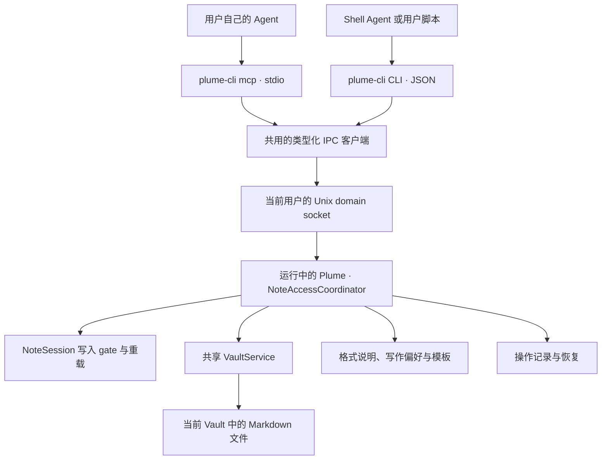

# Plume 本地 Agent 接入方案

| 项 | 内容 |
|---|---|
| 状态 | v3.1，首版代码与自动化验收完成；阶段 0 的实测与选择见 [agent-integration-phase0.md](agent-integration-phase0.md)，验收结果和发布前仍需人工完成的项见 [agent-integration-acceptance.md](agent-integration-acceptance.md) |
| 日期 | 2026-10-14 |
| 代码基线 | `99fd7af` |
| 目标 | 用户在自己的 Agent 中搜索、读取笔记，并按 Plume 格式和个人习惯创建、修改笔记 |
| 首版范围 | 本地 stdio MCP、共用逻辑的 CLI、写作上下文、创建、局部修改（会话当前笔记写盘后重载，用户编辑中拒绝）、版本检查、幂等与结果查询 |
| 后续范围 | 编辑器事务式修改（保留撤销、映射光标、编辑中也能修改）、当前选区、未落盘草稿、更多修改方式、更多 MCP transport、远程 Agent 接入 |

本文定义拟新增能力，接口名、文件布局和数量限制均为设计约定，不表示当前版本已经支持。现有行为以列出的仓库文件为依据。实施分阶段进行，但完整首版必须包含 `create_note` 和 `modify_note`。

### 修订记录

| 版本 | 日期 | 变更 |
|---|---|---|
| v1 | 2026-10-13 | 初稿 |
| v2 | 2026-10-14 | 对照代码 review：每次 summon 都会重置撤销历史，⌘Z 承诺收窄到 Panel 可见时；补充 TCC、helper 真实路径与 profile 解析、App Translocation、启动时的 Vault chooser、App Nap、沙箱化 Shell；凭据改存 `0600` 文件；明确行结束、Git 冲突标记、写入速率上限与格式语法；补充 lint 棘轮、命名、打包约束及对应验收项 |
| v3 | 2026-10-14 | 收窄首版范围：会话当前笔记改为写盘后重载，Panel 有焦点或有未保存输入时返回 `NOTE_BUSY`；读取只返回磁盘内容；首版不提供 ⌘Z 撤销 Agent 修改；编辑器事务、revision 与 barrier 移到第 14.1 节；相应精简操作状态、错误码、阶段与验收项 |
| v3.1 | 2026-10-14 | 设置页不提供“选择范例”，范例只由 `example_refs` 指定（第 9.2 节）；状态改为首版代码完成，余下手工验收见验收清单；发布前把 helper 由 `plume-agent` 改名为 `plume-cli`、凭据变量由 `PLUME_AGENT_TOKEN` 改为 `PLUME_CLI_TOKEN`（理由见[命名约定](naming-conventions.md)） |

## 1. 目标与关键决定

### 1.1 用户场景

用户在自己的 Agent 中完成讨论，希望自然地把结果留在 Plume：

> 把刚才的讨论按我的习惯整理进 Plume；有相关笔记就更新，没有就新建。

期望流程：获取写作上下文 → 搜索相关笔记 → 读取目标或范例 → Agent 整理 Markdown → 创建或修改 → 返回具体笔记与修改结果。

另一个常见场景是持续更新：

> 把项目笔记里的方案改为刚才确定的版本，补上两条待办，其他内容保留。

这要求修改支持局部替换，并与用户同时编辑、自动保存和同步带来的变化协调。

### 1.2 决策摘要

| 决定 | 理由 |
|---|---|
| 官方 stdio MCP 为主要入口，CLI 复用相同业务协议 | 接入支持本地 MCP 的 Agent，也覆盖具有 Shell 能力的 Agent |
| 随 Plume.app 分发原生辅助程序 | 安装应用即可使用，无需 Node、Python、源码或第二套手动安装 |
| Vault 相关 API 经本机 IPC 进入运行中的 Plume | 只有应用同时知道磁盘、编辑缓冲区、保存任务和当前 Vault；Vault 默认在受 TCC 保护的 `~/Documents` 或 iCloud Drive 中，访问授权属于 Plume.app，而 Agent 拉起的 helper 授权主体是 Agent 进程 |
| 应用是 API 写入的唯一执行者 | 避免不同 MCP 子进程各自写文件、竞争命名和绕过编辑会话 |
| 首版包含创建与修改 | 满足讨论结果落入笔记的完整场景 |
| Agent 负责生成内容，Plume 提供写作上下文并执行保存 | 用户选择自己的模型；Plume 无需模型账号、模型 SDK 或云端生成服务 |
| 修改要求版本，默认局部修改 | 保留用户原文与结构，发现并发变化后重新读取 |
| 首版对会话当前笔记“写盘后重载”，用户编辑中拒绝 | 复用现有外部修改的重载路径，不改编辑器与桥接；代价是撤销历史与光标映射，留给后续的编辑器事务 |
| 用户偏好与模板显式维护 | 先让行为可解释、可编辑，不依赖对整个 Vault 的隐式推断 |
| 本地连接默认关闭，提供只读和创建及修改两档 | 用户明确选择 API 开放的能力，已授权的写入无需每次弹窗 |
| 保存结果与同步结果分开 | 成功意味着本机笔记保存完成，不等同于已上传 iCloud 或 Git remote |

首版为了统一版本与权限语义，Vault 读取也走应用。应用退出时由辅助程序直接读取文件可以作为将来的只读优化，但需先解决 TCC：helper 直接读取 `~/Documents` 或 iCloud Drive 时，系统以拉起它的 Agent 为授权主体弹出访问请求，或直接拒绝。首版遇到应用未运行时启动应用，再完成请求。

### 1.3 首版边界

- 当前配置的一个 Vault，沿用现有平铺 `.md` 文件模型。
- 创建普通笔记；读取并修改有文件身份的笔记，包括会话当前笔记；用户正在编辑时（Panel 有焦点或有未保存输入）拒绝修改。
- 不提供删除、移动 Vault、修改设置、执行命令、访问任意文件或 Git 操作工具。
- 不提供未落盘草稿、当前选区、编辑器内的事务式修改（保留撤销历史）、批量跨笔记事务或模糊自动合并。
- 不将笔记格式改为数据库、强制 front matter 或隐藏块 ID。
- 用户仍可直接通过文件系统访问自己的 Markdown；API 权限不替代操作系统文件权限。

## 2. 现有实现与可复用边界

| 仓库位置 | 当前能力 | 设计中的用法与缺口 |
|---|---|---|
| [Settings.swift](../../Sources/PlumeKit/Persistence/Settings.swift)、[SettingsStore.swift](../../Sources/PlumeKit/Persistence/SettingsStore.swift) | `vaultPath` 指定当前 Vault；设置支持手动编辑与实时重载 | 应用负责发现 Vault；辅助程序不创建第二份 Vault 配置 |
| [BuildProfile.swift](../../Sources/PlumeKit/Support/BuildProfile.swift) | 正式版与开发版的 bundle、配置目录、Vault 隔离 | IPC、凭据、写作文件和操作记录也必须隔离 |
| [NoteIndex.swift](../../Sources/PlumeKit/Notes/NoteIndex.swift)、[NoteSearch.swift](../../Sources/PlumeKit/Notes/NoteSearch.swift) | 增量索引；标题与文件名模糊搜索，正文按字面搜索 | 复用算法，新增程序用 DTO；不直接暴露 Switcher 的本地化 UI 行 |
| [MarkdownDocument.swift](../../Sources/PlumeKit/Notes/MarkdownDocument.swift)、[NoteFilename.swift](../../Sources/PlumeKit/Notes/NoteFilename.swift) | 第一条非空行作为标题；文件名生成与重名处理；尾换行规范化 | 创建沿用同一实现；修改不重新生成文件名 |
| [VaultService.swift](../../Sources/PlumeKit/Vault/VaultService.swift) | 同一进程内串行执行 Vault I/O；维护索引；下载独立于写入队列 | API 复用同一个服务实例；串行队列不能约束应用外的文件写入 |
| [VaultIO.swift](../../Sources/PlumeKit/Vault/VaultIO.swift) | 文件协调、原子写入、磁盘原始字节 hash、iCloud 可用性检查、冲突副本 | 需增加 API 用严格更新语义；现有 `expectedHash: nil` 无条件写入和缺失文件重建行为不能直接用来修改 |
| [NoteSession.swift](../../Sources/PlumeKit/Session/NoteSession.swift)、[NoteSession+External.swift](../../Sources/PlumeKit/Session/NoteSession+External.swift) | 500 ms 自动保存、草稿物化、外部变化协调、创建初期标题跟随改名 | 增加 Agent 修改的忙碌检查、写入 gate 接缝与修改后重载；读取不得强制物化草稿 |
| [VaultReconciler.swift](../../Sources/PlumeKit/Vault/VaultReconciler.swift) | 打开中的笔记被外部修改：没有未保存输入时静默重载；有未保存输入时把缓冲区写进 `-conflict-` 副本并切换过去，显示冲突横幅 | 首版当前笔记修改复用重载；为避免 Agent 触发冲突副本，用户编辑中返回 `NOTE_BUSY` |
| [protocol.ts](../../Editor/src/bridge/protocol.ts)、[host.ts](../../Editor/src/bridge/host.ts) | Swift ⇄ Web 桥接；`loadNote` 替换全文并清空撤销历史 | 首版不新增桥接方法：当前笔记被修改后沿用 `loadNote` 整篇重载，这次 summon 的撤销历史随之清空；保留撤销的事务式修改见第 14.1 节 |
| [setup.ts](../../Editor/src/editor/setup.ts) | 未配置 `lineSeparator`：CodeMirror 按 `\r\n`、`\r`、`\n` 分行，以 `\n` 拼接；CRLF 笔记被用户编辑一次后，保存的就是全篇 LF | 首版修改都在磁盘侧执行，未改动片段保留 CRLF；之后用户在编辑器中编辑这篇笔记时，按现有行为整篇写成 LF |
| [PanelController.swift](../../Sources/Plume/Panel/PanelController.swift) | summon 时发送 `resetHistory`，撤销只属于本次 summon；dismiss 先 flush 并结束标题跟随，再把 Panel 停到屏幕外，WebView 保持运行；`showNews` 在 Panel 隐藏时把提示留到下次 summon | 收起后会话仍指向最后那篇笔记，Agent 可以修改它；提示在 Panel 可见时用 toast、隐藏时走 `showNews`；Panel 是否为 key window 用来判断用户是否在编辑 |
| [VaultCoordinator.swift](../../Sources/Plume/App/VaultCoordinator.swift)、[AppCoordinator.swift](../../Sources/Plume/App/AppCoordinator.swift) | 启动时先确定 Vault；首次启动创建 Vault 与欢迎笔记；Vault 缺失或不是目录时激活 App、弹出模态 chooser，`start()` 在用户选择前不继续 | helper 拉起 App 可能碰到 chooser；IPC 应答不能依赖 Vault 准备完成 |
| [GitSyncEngine.swift](../../Sources/PlumeKit/GitSync/GitSyncEngine.swift) | 一次同步是 commit → merge → push，冲突以 `<<<<<<<` 等标记原地留在笔记里；cycle 前由 `beforeCycle` flush 并 `drain()` | 工作树修改与 API 提交需要显式 gate；读取结果要标出冲突标记 |
| [dialect.ts](../../Editor/src/markdown/dialect.ts)、[decorate.ts](../../Editor/src/markdown/decorate.ts) | Plume Markdown 解析与显示规则 | 写作说明需与这些规则保持一致，不能笼统承诺完整 GFM 的显示效果 |

特别注意：`NoteIndex` 可收到编辑缓冲区内容，不等于持久化快照；API 的 `read_note` 必须明确返回内容来源与版本，不能仅从索引拿正文。`VaultService.drain()` 是主线程上的有界等待（退出、Move Notes 和 Git 同步前使用），不适合作为常规 API 成功确认机制。

## 3. 接入架构与生命周期

### 3.1 调用关系



辅助程序不写 Vault、`state.json` 或 `settings.json`。所有笔记变更由应用调度，使用现有的 Vault 服务和编辑会话。

### 3.2 辅助程序与安装

拟新增 SwiftPM 可执行 product `plume-cli`，随 App 分发到 `Plume.app/Contents/MacOS/plume-cli`。同一程序提供 `mcp` 子命令和普通 CLI，不维护两套笔记业务逻辑。

- 设置中的连接配置使用当前 App 的实际绝对路径；支持 Applications 之外的安装位置。App 被 Gatekeeper 随机化路径（App Translocation）或运行在只读卷（如挂载的 DMG）时，这个路径下次启动就会失效：设置不生成配置，提示先把 App 移到固定位置。
- 可选的用户级 CLI 链接只是便利功能，不依赖 `/usr/local/bin`、Homebrew 前缀或管理员权限。Homebrew 用户可由 cask 的 `binary` stanza 提供链接，在 [Packaging/plume.rb](../../Packaging/plume.rb) 中与应用一起评审。
- 移动 App 后重新复制连接配置；更新应用时重新启动 Agent 的 MCP 子进程。
- profile 由 helper 可执行文件的真实路径决定：解析符号链接后必须位于 `<App>.app/Contents/MacOS/`，读取该 App 的 `Info.plist` 得出 profile；不在 App bundle 内（例如直接运行 `.build/` 下的产物）时拒绝运行。不能直接用 `BuildProfile.current`：按真实路径运行时 `Bundle.main` 通常就是外层 App，但经符号链接或在 bundle 外运行时 bundle identifier 可能为空，而 `BuildProfile.resolve` 此时回落为 `.release`，开发用的 helper 就会连到日常笔记。环境变量也不能切换 profile。
- helper 只启动自己所属的 App；不根据显示名称搜索并启动其他安装副本。
- helper 不修改当前进程的用户主目录或替换操作系统级环境变量。
- helper 的 bundle 内路径、`mcp` 子命令和凭据环境变量名会写进用户的 Agent 配置，发布后按第 11 节的兼容面处理。

构建脚本需构建并拷贝 helper，覆盖 arm64/x86_64 产物；签名时先签 helper，再签 App，继续验证和公证完整 bundle。现有 [build-app.sh](../../Scripts/build-app.sh) 的单一可执行文件假设及预编译产物入口都要同步调整。

### 3.3 IPC 与应用启动

- 使用 Unix domain socket，无 TCP 端口，无远程监听。
- socket 位于当前用户专用、名称较短的临时运行目录；目录权限 `0700`，socket 权限 `0600`。不要把长的 Application Support 路径直接用作 socket 路径。临时目录取 `confstr(_CS_DARWIN_USER_TEMP_DIR)`，不读 `$TMPDIR`：Agent 客户端可能清空或改写子进程环境，两端会算出不同的路径。
- 每个用户、每个 profile 只有一个主应用 owner；由进程生命周期锁保护共享配置、journal 和 API 写入。相同 profile 的多个安装副本不能各自启动一个 writer。
- 按 profile 区分运行目录；包含安装实例标识，helper 与 App 在握手中核对实例、profile、IPC 主版本及应用版本。IPC 主版本不兼容才拒绝；应用版本不同只作诊断信息，因为应用更新后、旧进程尚未重启是正常状态。已有 owner 属于另一安装副本时返回 `APP_INSTANCE_MISMATCH`，提示使用正在运行的安装副本生成配置，不另启 writer。正式版与 Dev 可以各自运行。
- 运行目录定位规则需确定且可测试；验证 owner、类型及符号链接，避免连接到同名替代文件。
- 应用未运行时，通过 LaunchServices 非激活启动所属 App，等待有界的 ready 握手。正常请求不 summon Panel，不抢焦点，不自动打开新建笔记。
- helper 没有拿到凭据时直接返回 `AUTH_FAILED`，不启动 App。接入默认关闭，未配置的调用不应让 App 跑首次启动流程、创建 Vault 和欢迎笔记。
- IPC listener 在 Vault 准备之前启动。现有启动流程在 Vault 缺失或路径不是目录时会激活 App 并弹出模态 chooser；这是用户必须处理的状态，沿用现有 chooser，但 helper 应在握手中收到 `VAULT_UNAVAILABLE`，而不是等到超时。
- 处理请求期间用 `ProcessInfo.beginActivity(options: .userInitiated, …)` 标记活动。Plume 平时是没有可见窗口的 accessory 应用，可能处于 App Nap，计时器与回调会被合并延后。
- 已有应用尚未就绪、IPC 不兼容、Vault 缺失、首次设置未完成或调用超时时返回明确错误，不退回 helper 直接写文件。
- socket 由应用拥有；清理陈旧 socket 前检查没有活跃 owner。多个 MCP 子进程连接同一应用。
- 正常关闭停止接受新写入，完成或记录正在执行的操作；不能只断开连接就遗忘写入结果。

建议初始限制：本地 ready 等待 5 秒、普通请求 10 秒。下载使用独立的较长等待与取消机制，不占用 Vault 写入队列。具体数值是首版默认值，实施时通过冷启动和 iCloud 实测校准。

### 3.4 MCP 与 CLI 协议

MCP adapter 限定在辅助程序 target。`Package.swift` 目前没有任何第三方 Swift 依赖，引入 SDK 会同时带来 `Package.resolved`、首次构建的联网解析、universal 构建和 `THIRD_PARTY_NOTICES.md` 的维护。阶段 0 对比两条路径后再决定：维护中的 Swift MCP SDK；或只实现首版需要的 stdio 子集——按行分隔的 JSON-RPC 2.0，`initialize`、`notifications/initialized`、`ping`、`tools/list`、`tools/call`、`notifications/cancelled` 与 `notifications/tools/list_changed`。对比项：stdio、初始化/能力协商、tools schema、错误与取消处理、macOS 14、仅用 CLI Tools 离线构建、二进制体积和许可证。两种方式首版都不实现 HTTP transport、resources、prompts 或 sampling。

IPC 使用有大小上限的长度前缀 JSON 消息，强类型解码。未知方法、类型错误与未知主版本明确拒绝。外部 JSON 不能复用编辑器桥接中面向 UI 的宽松解码。

MCP 与 CLI 共用领域请求和结果：

- MCP 通过协商后的标准工具结果返回结构化数据与简短文本摘要；业务失败使用工具错误结果，保留领域错误码。JSON-RPC 层错误仅用于协议问题。
- CLI 默认 `--json` 可用；JSON 输出与业务结果一致，诊断只写 stderr。成功退出码为 0，业务失败为 1，命令用法错误为 2。
- stdio MCP 的 stdout 只输出协议消息，日志、启动信息和 Swift 诊断进入 stderr。
- 日志不记录笔记正文、模板内容或连接凭据。
- 部分 CLI Agent 在受限沙箱中执行 Shell 命令，可能拒绝连接本机 socket 或调用 LaunchServices。helper 把这类 `EPERM`/`EACCES` 报告为 `CONNECTION_BLOCKED`，提示改用由客户端直接启动的 MCP，或在 Agent 的沙箱配置中放行；不降级为直接读写文件。

## 4. 工具与内容版本

### 4.1 首版工具

| 工具 | 主要输入 | 结果与约定 |
|---|---|---|
| `get_writing_context` | 可选 `target`、`template_id`、用户明确选择的 `example_refs` | 格式说明、写作偏好、模板和有限范例；说明来源与版本 |
| `list_notes` | 可选 `cursor`、`limit` | 分页元数据，包含 `note_ref`、标题、修改时间、可用性；不返回正文 |
| `search_notes` | `query`、可选 `cursor`、`limit` | 排序结果与匹配片段；标题与文件名按子序列模糊匹配，正文按整个查询串字面匹配，工具说明提示 Agent 用短关键词分次搜索 |
| `read_note` | `note_ref`、可选 `download` | Markdown、版本、来源、未保存状态与格式警告 |
| `create_note` | `markdown`、`request_id` | 已保存文件的引用、实际文件名、版本与操作结果 |
| `modify_note` | `note_ref`、`expected_version`、`changes`、`request_id` | 局部修改后的引用、版本与操作结果 |
| `get_operation` | `request_id` | 查询超时、断连或恢复中的写入；不暴露正文 |

`get_operation` 是为可靠写入增加的辅助工具。权限不足时写工具不出现在 `tools/list` 中，服务端仍需逐请求校验权限。权限变化后按客户端协商能力发送工具列表变更通知；即使客户端缓存旧列表，应用也拒绝未授权调用。

所有返回结果包含 `api_version`。元数据中的时间使用 ISO 8601，不返回 Switcher 的“刚刚”“今天”等本地化显示字符串。

### 4.2 笔记引用与 Vault 变化

`note_ref` 是不透明的引用，绑定 profile、Vault 身份与该文件名，不接受任意绝对路径。内部文件名可作为返回的可读字段，不作为客户端自由拼接路径的入口。

- 不往笔记写 UUID 或 front matter；不改变现有文件身份模型。
- 改标题不会改变已有笔记文件名。Agent 创建的笔记以完成的正文一次命名，不进入“刚创建、跟随标题变化”的编辑阶段。
- 用户手动改名或外部删除后，旧引用可能失效；返回 `NOTE_NOT_FOUND` 并重新搜索，不用猜测内容相同的文件就是原文件。
- API 暴露处于标题跟随阶段的已有笔记前，应通过会话结束其自动改名状态，让返回的引用保持稳定；这不等于保存或重写内容。该阶段只存在于 Panel 创建笔记后、尚未 dismiss 或切换笔记之前，与现有“其他程序按路径知道这个文件后不再改名”的规则一致。
- 切换、移动 Vault 时暂停新写入。完成或恢复已经准备的操作后再切换，增加 Vault epoch，使旧引用与版本不能写入新 Vault。
- 队列任务捕获原 Vault 身份，执行前再次核对；不能在执行时只读取可变的全局 `vaultPath`。
- 同一路径的文件被替换仍需重新做版本检查；首版不承诺任意外部 rename 的持久追踪。

路径边界在应用端实现：只处理 Vault 根目录下的普通、非隐藏 `.md` 文件；拒绝路径分隔符、`..`、控制字符、符号链接、目录和边界外文件。复用 `NoteFilename.isNoteFile` 前补充边界验证，因为它目前只检查文件扩展名与隐藏文件。预检查不能替代 I/O 边界检查；在协调 accessor 中再次核对文件类型与目标，读取使用不跟随符号链接的打开方式。

### 4.3 读取与版本

首版 `read_note` 只返回磁盘上已保存的内容，经共享 Vault 队列读取。

```json
{
  "api_version": 1,
  "note_ref": "note:opaque-reference",
  "filename": "2026-10-13-1430-agent接入.md",
  "title": "Agent 接入",
  "markdown": "# Agent 接入\n\n## 待办\n\n- [ ] 完成接口设计\n",
  "version": "version:opaque-snapshot",
  "source": "disk",
  "has_unsaved_changes": false,
  "availability": "available",
  "warnings": []
}
```

`version` 与 `note_ref` 都由服务端生成。上述字符串只是示例。对调用者，版本是相等比较用的 token，不是时间戳，也不能把正文 hash 自行拼成版本。

服务端快照至少记录：Vault epoch、文件身份、磁盘原始字节 hash 与返回正文的 hash。内部原始字节 hash 与返回文本的 hash 分开，因为加载会规范化尾换行。

目标是会话当前笔记且缓冲区有未保存输入时，`has_unsaved_changes` 为 `true`：返回的是上一次保存的内容，屏幕上更新的部分要等自动保存（停止输入后 500 ms）落盘后才能读到。此时修改会返回 `NOTE_BUSY`，Agent 稍后重新读取即可。读取不保存、不改变光标与撤销历史，也不物化草稿；第 4.2 节的自动命名冻结是唯一显式的会话身份调整。读取编辑器中未保存内容的快照属于第 14.1 节的后续能力，届时 `source` 才会出现 `editor`。

版本在应用重启、Vault 切换、文件改名或快照过期后失效，调用方重新读取。建议快照缓存有效期为 10 分钟，返回值提供 `version_expires_at`；该缓存上限与驱逐策略由同一处常量定义。操作查询返回的是历史保存结果，其 version 也可能失效，继续修改前应重新读取。

行结束显式处理。API 返回的 `markdown` 一律是 LF，`old_text` 也按 LF 匹配，Agent 不必复现 `\r`；快照保留返回文本与磁盘原文之间的行结束映射。首版所有修改都在磁盘侧执行：未修改的片段保留原有 CRLF，新片段使用请求中的文本，不顺便重写全篇。当前笔记修改后重载到编辑器，此后用户再编辑这篇笔记时，按现有行为整篇写成 LF（见第 2 节 `setup.ts`）。

### 4.4 分页、下载与上限

- `list_notes` 默认按修改时间倒序，文件名作稳定的次级排序。`search_notes` 复用相关性排序。
- cursor 绑定查询与短期结果快照；过期返回 `CURSOR_EXPIRED`，不承诺长期遍历时完全冻结 Vault。
- iCloud 未下载文件列出 `availability: "evicted"`；搜索返回覆盖范围，明确哪些文件正文未参与检索。
- `read_note` 默认不触发下载，返回 `NOTE_NOT_AVAILABLE`；`download: true` 表示调用者允许取回该篇内容。使用独立下载队列并报告进度，不自动下载整个 Vault。
- 保存本地文件后继续走已有 iCloud/Git 同步流程；成功结果标记 `saved_locally: true`，不等待远端上传，不触发强制 Git push。

建议初始上限：列表每页默认 20、最多 100；单篇正文 1 MiB UTF-8；单次修改最多 32 项；IPC 消息最多 4 MiB；写作范例最多 3 篇，总输出正文最多 32 KiB。超限返回明确错误，不能截断正文后继续修改。已有较大笔记仍保留在 Vault，API 返回 `CONTENT_TOO_LARGE`。

写入另设速率上限，暂定每分钟创建与修改合计 30 次，超限返回带 `retry_after` 的 `RATE_LIMITED`，不排队延后执行。写入不逐次确认，这个上限防止失控的 Agent 循环在用户察觉前生成大量笔记或反复改写。

这些限制需契约测试并在接入说明中公开。

## 5. 写作上下文与 Plume 格式

### 5.1 三类信息

| 类型 | 管理者 | 保存位置与角色 |
|---|---|---|
| 格式能力说明 | Plume 随版本维护 | App 资源中的机器可读能力描述与写作说明；描述实际解析和显示效果。面向 Agent 而非界面，用单一英文版本，不进入 `Locales/` |
| 写作偏好 | 用户 | Application Support 下的普通 UTF-8 Markdown 文件；设置中可编辑、定位 |
| 模板 | 用户 | 同目录下的模板文件夹；按用途提供结构，Agent 根据本次对话填写 |

拟定存储：

```text
~/Library/Application Support/Plume/
  Agent/
    token
    preferences.md
    Templates/
      meeting.md
      discussion.md
      project.md
    Operations/
```

开发版对应 `Plume (Debug)`。这些是机器上的接入配置，不进入 Vault、不成为普通笔记、不默认加入笔记 Git 同步。用户可自行同步这些普通文件；首版不增加隐式同步机制。

`preferences.md` 与 Templates 是用户写的内容，按 [Packaging/plume.rb](../../Packaging/plume.rb) 中 `zap` 注释的标准（是 Plume 的留存物，还是用户的文档）不列入卸载清理。凭据文件和 Operations 是否列入要单独给出理由：操作记录里有笔记的恢复快照。

首次用户启用接入时可生成偏好与模板示例；不覆盖用户编辑或删除过的示例。文件缺失表示没有对应偏好，不擅自从其他笔记推断。Agent 没有通过笔记工具修改偏好、模板或连接权限的能力。`template_id` 只解析 Templates 中已登记的普通文件，拒绝路径穿越与符号链接；偏好和模板同样检查 UTF-8、大小和权限，超限或格式错误返回上下文警告，不返回不完整规则冒充完整偏好。

### 5.2 优先级与输出结构

建议 Agent 按以下顺序处理：

1. 本次用户明确要求。
2. 用户保存的写作偏好及本次指定模板。
3. 目标笔记或明确选择的范例所体现的既有结构。
4. Plume 提供的默认建议。

格式能力是显示约束，不能因风格偏好而声称一种未支持的语法可以渲染。用户明确要求保存原始 Markdown 时允许原样保留，并返回格式提示，不强行改写。

`get_writing_context` 返回 `format_version`、`preferences_version`、模板版本、各段来源、建议优先级及警告。版本是帮助 Agent 判断是否需要重读上下文的信息，不强制让偏好变化阻止已经生成的内容保存。

- 编辑目标时可以附带该目标的短片段与结构提示；版本与正文仍以 `read_note` 为准。
- 范例仅限用户选择或 Agent 基于明确任务搜索到的笔记，不自动遍历并返回全部 Vault。
- 截断只适用于风格范例，必须带 `truncated`；不能把截断范例当作完整修改依据。
- 模板和笔记内容作为数据返回，明确标注来源。笔记正文中的指令不视为连接权限或用户授权。
- 接入帮助提醒用户：内容由其 Agent 处理；使用云端模型的 Agent 时，所读内容可能发送给该模型服务。Plume 本身不增加模型网络请求。

### 5.3 推荐生成规则

随版本维护的说明至少覆盖：

- 笔记为 UTF-8 Markdown；标题来自第一条非空行，不必另传一个可能与正文冲突的标题字段。
- 新建默认建议以 `# 标题` 开始；编辑沿用已有标题习惯。
- 支持的常用显示包括标题、段落、列表、无序任务列表、引用、代码块、强调、删除线、链接，以及高亮 `==文本==` 与下划线 `<u>文本</u>`。后两种没有解析器节点，按行内文本匹配，写在代码里不生效。
- 块标记需要空格，例如 `# 标题`、`- 项目`、`> 引用`。
- 任务用 `- [ ] 文本`、`- [x] 文本`；有序列表中的 `[ ]` 保留为普通文本。
- 列表项只容纳文本：同一行不能出现第二个列表标记（`- - 项目`），嵌套列表另起一行缩进。列表项内的标题、规则线、引用、代码块、表格、HTML，以及引用内的标题、规则线、代码块、表格、HTML，不按通常 CommonMark/GFM 的嵌套方式解释；引用内可以有段落、列表和更深一层引用。复杂块内容放到顶层。
- 当前表格不提供专门的表格显示，图片保留 Markdown 原文；不要把语法可解析等同于拥有完整可视化展示。
- 不承诺 Mermaid、数学公式、脚注、Wiki 链接或 YAML 元数据的专门显示。默认模板不生成这些结构，也不在首行放 front matter，以免影响标题识别。
- 生成来源、日期、参与者、待办负责人等仅在偏好、模板或用户要求时加入；不自动附加整段聊天记录或“由 AI 生成”尾注。

### 5.4 校验与规范化

服务端严格校验编码、大小、路径、请求结构和修改前提。正文不为空的创建可以包括没有可提取标题的内容，此时沿用现有 `untitled` 命名；纯空白创建拒绝。

保存只复用现有尾换行规范化；不重排列表、不重写标题、不插入元数据，不改变正文中间的 CRLF 或用户措辞。`modify_note` 也不改变标题对应的文件名。

首版的格式检查是明确规则与有限警告，不复制一套 Swift Markdown parser 来宣称完整语法校验。需要语法树的警告复用实际编辑器 parser，并以同一组夹具验证格式能力说明；工具声明的渲染能力变更必须连同实际 WKWebView 表现一起更新。

## 6. 创建与修改契约

### 6.1 创建

```json
{
  "markdown": "# Agent 接入讨论\n\n## 结论\n\n采用本地 MCP。\n\n## 待办\n\n- [ ] 实现创建和局部修改\n",
  "request_id": "7ac18057-b3bc-4b43-8146-e77aa657ac19"
}
```

应用在共享队列中生成并预留唯一文件名，以当前 Vault 为目标，调用一次创建。命名来自正文，不接受任意 filename 或 path。为操作恢复增加可追踪的创建入口，但命名算法与 UI 创建共用。预留记录只能约束本应用；最终创建需保证目标原先不存在，使用排他创建/不覆盖的发布方式。外部进程占用预留路径时明确冲突，不能用现有无条件写入覆盖它。

成功返回 `operation_id`、`note_ref`、`filename`、`version`、`saved_locally: true`、`changed: true` 及格式警告。应用不自动 summon 新笔记；后续用户可以从 Switcher 找到它。

### 6.2 局部修改

```json
{
  "note_ref": "note:opaque-reference",
  "expected_version": "version:opaque-snapshot",
  "changes": [
    {
      "kind": "replace",
      "old_text": "采用 HTTP 服务。",
      "new_text": "采用本地 stdio MCP，并通过 IPC 交给 Plume 保存。"
    },
    {
      "kind": "append",
      "text": "\n\n## 待办\n\n- [ ] 完成桥接协议\n"
    }
  ],
  "request_id": "3356bbfe-946b-45c0-b119-54a89913d171"
}
```

首版只提供两种操作：

| 操作 | 前提 |
|---|---|
| `replace` | 非空 `old_text` 在读取快照中唯一匹配；`new_text` 可为空，表示删除这段内容 |
| `append` | 在同一个读取快照的末尾追加指定原文；每个请求最多一项 |

所有替换匹配同一份原始快照，不逐项匹配前一项的输出；区间不得重叠。正文插入可用“替换唯一锚点为锚点加新内容”表达。先验证所有区间，再一次生成候选正文，一个请求整体提交，不出现前两项成功、第三项失败。

追加不自动猜测分节、换行和来源格式，Agent 负责提供需要的间隔；最后按 Plume 规则规范化尾换行。替换使用返回正文的精确文本，不忽略大小写、不模糊匹配、不自动匹配第一个相似段落。

不公开字符 offset，避免模型计数错误、Unicode 与 UTF-16 单位混淆。内部区间由程序计算，并通过 emoji、组合字符及 CRLF 测试。

全文重写首版不单独提供模式；必要时可用整篇读取正文作唯一 `old_text`，仍受版本与大小限制。后续有明确需求再增加带显式语义的全文替换。修改为空文本会造成隐式删除整篇内容，因此首版拒绝纯空白的最终正文。

### 6.3 失败与无变化

- 匹配不到、出现多次、区间重叠或候选正文不合法：返回具体错误，文件和编辑器都不变。
- 版本失效：返回 `VERSION_CONFLICT` 或 `VERSION_EXPIRED`，不自动重读后把原修改盲目重放。
- 候选正文与磁盘内容相同：返回 `changed: false`，不写文件。
- 文件已删除：返回 `NOTE_NOT_FOUND`，不能因为已有 `expectedHash` 就重建原路径。
- 冲突不自动创建一篇新笔记再报告修改成功；需要另存时由用户或 Agent 明确调用创建。

## 7. 编辑、文件与同步的协调

### 7.1 修改前的版本检查

修改必须同时检查：

1. profile、Vault 身份与 epoch 一致，文件仍存在且可用。
2. 磁盘原始字节 hash 与读取快照一致（在协调区间内比较）。
3. 目标是会话当前笔记时，用户不在编辑：Panel 不是 key window，缓冲区与 baseline 一致，没有进行中的保存、改名或下载（见第 7.2 节）。
4. 没有尚未结算的写入、创建、改名或 Vault 迁移正在改变目标。

第 3 项不满足时返回 `NOTE_BUSY`，带可重试标志和原因（`editing`、`unsaved_changes`、`saving`）；版本变化后必须重新读取。不要用阻塞主线程的 `drain()` 或同步等待绕过状态协调。

仅磁盘 hash 匹配不够：用户读完后的新输入可能还在 500 ms 防抖内、尚未落盘；仅看缓冲区也不够：外部工具或同步可能已经改变文件。

### 7.2 会话当前笔记

“当前笔记”以会话的 `currentFilename` 为准，不等于 Panel 可见：dismiss 只把 Panel 停到屏幕外，会话仍指向最后显示的那篇。首版不改编辑器，把 Agent 当作外部修改者，复用现有“外部修改后重载”的路径，只在它会制造冲突副本之前拦下：

| 状态 | 行为 | 用户看到的 |
|---|---|---|
| Panel 已收起 | 允许 | 下次 summon 时是新内容，并有 `showNews` 提示；撤销历史本来就会在 summon 时重置 |
| Panel 显示中、不是 key window，且没有未保存输入 | 允许 | 内容原地整篇刷新，出现 toast；这次 summon 的撤销历史清空；光标回到记录的字符偏移（夹到正文长度），开启自动高度时面板高度随内容变化 |
| Panel 是 key window，或有未保存输入、进行中的保存/改名/下载 | `NOTE_BUSY`（可重试） | 编辑器与文件都不变 |

用户正在编辑时必须拒绝：现有协调遇到“磁盘被改、缓冲区有未保存输入”，会把缓冲区写进 `-conflict-` 副本、Panel 切到副本并显示冲突横幅。文字不会丢，但这个冲突是我们自己的 API 制造的。Agent 收到 `NOTE_BUSY` 后可以稍后重新读取再试、请用户收起 Panel，或改为新建笔记。

提交顺序：

1. 在主线程按上表检查，并占用会话的写入 gate（与自动保存、改名同一个）；期间触发的自动保存按现有逻辑延后。
2. 在共享 Vault 队列中按第 7.3 节严格更新写盘。
3. 写盘成功后回到主线程。缓冲区仍等于原 baseline 时，直接更新缓冲区与 baseline、发送 `loadNote`，并结束标题跟随（与现有外部写入规则一致），不等 FSEvents；之后到来的事件因磁盘与 baseline 一致被视为无变化。然后按上表显示提示，释放 gate。
4. 写盘失败时文件保持原样（原子替换），编辑器不变，返回 `SAVE_FAILED`。

检查与写盘之间有一个很短的窗口：用户恰好点进 Panel 开始输入。此时第 3 步发现缓冲区已变，不发送 `loadNote`；释放 gate 后，延后的自动保存按现有冲突处理把用户输入写进 `-conflict-` 副本。用户的文字不丢，Agent 的修改已保存到目标，操作仍是成功，并在 `warnings` 中注明。写盘完成后直接重载、不等 FSEvents，就是为了把这个窗口压到一次队列写入的时长。

用户在修改进行中切换笔记、收起 Panel 或退出时，写入照常完成并结算；第 3 步只在目标仍是当前笔记时重载，不会作用到新打开的笔记。

未落盘草稿首版不获得 `note_ref`；Agent 新建笔记与用户当前草稿独立，不覆盖或强制保存草稿。

### 7.3 未打开笔记

在共享 Vault 队列中使用新的严格更新方法：

- 检查已有文件，要求非空 `expectedHash`，拒绝 missing/evicted。
- 在 `NSFileCoordinator` accessor 内比较最新 hash，再原子写入。
- hash 不匹配时返回冲突，不写 sibling，不覆盖、不重建。
- 写入后更新索引，通知菜单和 Switcher；用户后来打开的是已保存版本。

目标在检查与写盘之间被用户打开时：打开时的读取排在写入之后，就直接读到新版本；排在之前，则由现有的外部修改协调接手，没有未保存输入时重载。

### 7.4 应用外写入的边界

`NSFileCoordinator` 能协调配合该协议的进程，不能阻止任意 Shell 重定向、同步工具或 Git 在检查和替换之间写入。不能宣称 API 与所有外部进程具备全局事务隔离。

- 串行化应用内 API、UI 保存和改名；API 严格 hash 检查在协调区间内完成。
- Git cycle 的工作树修改与 API 提交通过显式 gate 协调。网络 fetch 不长期占用提交 gate，commit/merge 等会接触工作树的阶段必须有明确排他关系。
- Git 合并冲突以标记原地留在笔记里。`read_note` 与 `search_notes` 对含冲突标记的笔记返回警告，写作说明要求 Agent 不自行消解冲突，除非用户明确要求。修改仍按版本规则执行，因为用户可能正是要 Agent 帮忙合并。
- FSEvents 与现有外部协调继续处理同步到来的变化；发现不一致时结束操作并报告实际状态。
- 提交前在操作记录中保留修改前后快照；异常时可以恢复，但不承诺替不受协调的其他进程保留所有中间版本。
- 返回成功后发生的新修改是新的内容版本；成功只证明本次本地保存完成，不承诺后续文件一直保持不变。

### 7.5 撤销与恢复

首版不提供用 `⌘Z` 撤销 Agent 修改。当前笔记被修改后经 `loadNote` 整篇重载，这次 summon 中已有的撤销历史一并清空；Panel 收起时被修改的，撤销历史本来就会在下次 summon 时重置（每次 summon 都发送 `resetHistory`，防止 ⌘Z 越过 dismiss 清空一篇一口气写完的笔记）。保留撤销的修改方式见第 14.1 节。

所有 Agent 修改都通过操作记录回退：操作记录保留受保护的修改前快照，首版设置中的最近写入可提供“查看结果”和“恢复修改前版本”。恢复要求目标仍与本次操作结果一致；若后来已经变化，则拒绝覆盖，让用户显式另存恢复内容。

恢复内容通过同一写入路径，产生新的操作，而不是倒置 journal 状态；恢复当前笔记同样按第 7.2 节检查与重载。暂定完成操作的恢复快照保留 7 天；用户清除记录也清除恢复快照。恢复是首版写入的可恢复性要求，不依赖未启用的 Git 同步。

## 8. 幂等、超时与崩溃恢复

### 8.1 请求身份

每次创建或修改要求调用者生成 UUID `request_id`，重试同一操作沿用该 ID。JSON-RPC request id 不能代替它，因为连接重建和工具重试可能改变传输层 ID。

去重身份绑定 profile、连接授权代际与 `request_id`，在绑定当前 Vault 或校验版本有效期前先查操作记录。Vault 身份在第一次接受请求时固定并写入记录；即使之后切换 Vault，同一 ID 的创建重试也只能返回原操作，不会在新 Vault 再创建一篇。`get_operation` 按授权代际与 ID 查询，包括已不再是当前 Vault 的历史操作。

输入摘要覆盖固定的 Vault、目标、expected version 与类型化请求的确定性 JSON 序列化。精确匹配用的 `old_text`、替换和追加文本保留原文，不为了计算摘要而 trim 或改写；创建正文可按既有尾换行规则统一。

- 同一 ID 与同一输入：返回已有状态或结果，不再次创建、替换或追加。
- 同一 ID 与不同输入：`REQUEST_ID_REUSED`，拒绝执行。
- 同一 ID 的并发调用：加入同一进行中的操作，不能各自写入。
- 冲突后重新读取、重新生成的修改是新操作，应使用新 ID。

### 8.2 状态与保存确认

```text
accepted → prepared → saved
                 ↘ rejected
                 ↘ outcome_unknown
```

- `accepted`：登记请求，尚未发生正文变更。
- `prepared`：将目标、请求摘要、修改前后快照和预留文件名持久化，尚未执行提交。
- `saved`：本地文件保存完成，终态与结果已经持久化，才向调用者返回成功。
- `rejected`：前提检查失败或写盘失败，保证本次操作未修改正文（写入是原子替换，失败时文件保持原样）。
- `outcome_unknown`：无法根据恢复证据确定结果；需要检查实际笔记。

首版的修改先写盘、再重载编辑器，不存在“已进缓冲区、未落盘”的中间态。第 14.1 节的编辑器事务加入后，再增加 `applied` 与相应的恢复状态。

操作恢复按 Vault 和文件排队，未处理操作不能与下一次同目标写入互相绕过。跨笔记没有原子事务承诺。

### 8.3 journal 与文件不是同一个事务

准备记录必须先于笔记变更落盘，完成记录必须先于成功响应落盘。journal 位于 Application Support 的 `Agent/Operations/`，目录权限 `0700`，记录及恢复快照权限 `0600`，使用原子文件更新，并验证应用崩溃后的读取；日志输出不代替 journal。应用被强制退出与突然断电是不同的持久化条件，阶段 0 需明确文件及目录同步策略，再陈述断电时的保证。

笔记文件与完成记录无法简单地一起原子替换。应用启动恢复未完成操作时：

| 观察结果 | 行为 |
|---|---|
| 目标仍是修改前版本 | 可继续该请求的准备/提交，不重新生成内容 |
| 目标与记录的结果版本一致 | 记录恢复后的已保存结果，不重复追加或创建 |
| 创建预留路径不存在，且没有其他执行证据 | 继续创建到同一预留路径，不重新生成另一个名称 |
| 目标已变化、路径被占用，或证据不一致 | 保留恢复快照并标记不确定；不覆盖文件，不自动创建第二篇 |

首版先写盘后重载，崩溃时不会有只存在于缓冲区的 Agent 内容；重启后会话从磁盘加载即可。

同一 ID 的结果与快照完整保留 7 天，之后保留紧凑的 ID、输入摘要和终态记录 90 天，阻止旧 ID 被再次执行；`get_operation` 对被裁剪的结果返回 `OPERATION_EXPIRED`。紧凑记录在启动时按期清理（与 Recently Deleted 的到期清理同一时机），避免无限增长；客户端重试不会跨越这个时长。用户明确清除全部操作记录时同时轮换授权代际，重置去重历史，此后旧授权不能继续查询或重试。

不要把有限的恢复机制表述为任意故障下的 exactly-once；设计保证的是可追踪、重复请求不盲目重放，以及无法证明结果时显式停下。

### 8.4 超时、断连与取消

调用者超时或断开连接不代表未写入。CLI 和 MCP 错误保留 `request_id`，指示先调用 `get_operation`。

- 准备前可以取消，结果为未应用。
- 进入准备/提交后取消只停止等待；应用必须完成提交、恢复或记录不确定结果。
- 未返回成功不能反推出文件没变化。
- journal 完成记录写入失败时，不返回普通成功；保持请求处于可查询的恢复状态，并保留写入证据。
- 权限撤销阻止新的写入；已进入提交的操作需要安全结算，不在中途丢弃记录。

## 9. 权限、设置与可见性

### 9.1 首版授权模型

连接权限在本机、按 profile 管理：关闭、只读、允许创建及修改。首版所有已配置连接共用一套授权代际和凭据，不宣称能识别每个 Agent 的真实身份；`client_label` 仅作为调用者提供的显示信息。

- 首次启用生成高熵本地凭据，应用端保存在 `Agent/` 下权限 `0600` 的单独文件中，不写入 Vault 或普通 `settings.json`。不用 Keychain：凭据本来就以明文写在 Agent 的客户端配置里，同一用户的进程都读得到，Keychain 不增加实际保护；而 Dev 构建是 ad-hoc 签名，每次重新构建签名都会变，访问旧条目会弹出钥匙串授权，与 Plume 不弹权限请求的做法冲突。凭据的作用是确认客户端经过用户配置，不是对抗同用户进程的安全边界。
- 设置提供可复制的客户端配置，凭据通过客户端支持的环境或 secret 配置传给 helper；helper 在 IPC 握手提供凭据，应用逐请求检查当前权限。
- 配置示例只出现占位值，不把真实凭据写入项目文档、日志或命令行 argv。
- 临时 socket 的 owner/peer UID 检查与凭据检查共同限制意外访问；同一用户下具有完整文件和进程访问权的程序不被此机制强沙箱隔离。
- 撤销连接使旧凭据失效，关闭 listener 或拒绝旧连接的新请求；重新启用生成新授权代际。
- 首版不做每次写入确认。用户在 Agent 中明确要求保存，且已授予创建及修改权限时直接执行。

helper 只从客户端配置获取凭据，不读取应用端的凭据文件；否则任何能运行 helper 的进程都等于已配置。全局权限可用后，再考虑每个连接单独 scope、单独撤销与访问记录。

### 9.2 设置入口

在设置窗口新增“连接你的 Agent” tab（暂定 `settings.tab.agent`），布局按 [Settings 窗口设计规范](../Specs/settings-design-spec.md) 的页 → 卡片 → 行，至少包括：

- 启用与权限选择。
- 当前连接状态、复制 MCP 配置、复制 CLI 路径和查看连接说明。
- 编辑写作偏好、管理模板。范例不在设置中维护：用户在对话中把笔记指给 Agent，或由 Agent 按本次任务搜索，再通过 `example_refs` 传入（第 5.2 节）。设置里固定的范例列表会成为新的存储兼容面，而且要靠用户额外维护；首版不提供。
- 最近写入：时间、调用者显示名、笔记标题、创建/修改/恢复、结果。
- 定位笔记、查看可恢复版本、清除记录及撤销连接。

普通成功写入不弹确认、不抢焦点。当前笔记被修改时显示简短提示：Panel 可见时用 toast，隐藏时用 `showNews` 留到下次 summon；保存失败使用现有问题提示方式。内部 hash、socket 路径和 journal 状态放在诊断中，不进入常规使用流程。

设置和提示文案同时更新 `Locales/en`、`Locales/zh-Hans`：提示沿用已有的 `toast`、`news` 前缀，新 tab 只开 `agent` 一个前缀，按 [Locales 约定](../../Locales/README.md) 添加键。业务错误码保持机器稳定，用户解释可本地化。

### 9.3 客户端配置示例

下面是支持 `mcpServers`、`command`、`args`、`env` 的客户端配置形状；具体客户端可能不同，设置说明要按实际兼容客户端生成，不能宣称一份 JSON 适用于所有 Agent。

```json
{
  "mcpServers": {
    "plume": {
      "command": "/Applications/Plume.app/Contents/MacOS/plume-cli",
      "args": ["mcp"],
      "env": {
        "PLUME_CLI_TOKEN": "<从 Plume 连接设置获取的凭据>"
      }
    }
  }
}
```

示例 CLI：

```sh
plume-cli context --json
plume-cli notes search --query 'Agent 接入' --json
plume-cli notes read --ref 'note:opaque-reference' --json
plume-cli notes create --input ./note.md --request-id '<UUID>' --json
plume-cli notes modify --input ./changes.json --json
plume-cli operations get --request-id '<UUID>' --json
```

正文来自 UTF-8 文件或 stdin，不要求用户把长文本、换行或凭据放入 Shell 命令字符串。`modify` JSON 与工具输入一致。

## 10. 错误契约

领域失败以 `code`、简短 `message`、`retryable` 和必要的 `details` 返回，涉及写入时始终返回 `request_id` 与已知操作状态。错误码按语义稳定，客户端不能靠匹配本地化消息判断结果。

| 类别 | 主要错误 | 客户端动作 |
|---|---|---|
| 连接与授权 | `ACCESS_DISABLED`、`AUTH_FAILED`、`PERMISSION_DENIED` | 用户在设置中启用或更新配置；不循环重试 |
| 运行与协议 | `APP_NOT_READY`、`APP_INSTANCE_MISMATCH`、`PROTOCOL_MISMATCH`、`REQUEST_TIMEOUT`、`CONNECTION_BLOCKED` | 等待 ready 或更新为运行中安装副本的配置；写入超时先查操作；被 Agent 沙箱拦截时改用 MCP 或调整沙箱配置 |
| Vault 与身份 | `VAULT_UNAVAILABLE`、`VAULT_CHANGED`、`NOTE_NOT_FOUND`、`INVALID_NOTE_REF` | 检查当前 Vault，重新列举和读取；不自动重建路径 |
| 内容可用性 | `NOTE_NOT_AVAILABLE`、`DOWNLOAD_TIMEOUT`、`CONTENT_TOO_LARGE` | 显式下载或缩小操作；不把占位文件当空笔记 |
| 版本与匹配 | `VERSION_CONFLICT`、`VERSION_EXPIRED`、`MATCH_NOT_FOUND`、`MATCH_AMBIGUOUS`、`CHANGES_OVERLAP` | 重新读取和评估修改，使用新请求 ID |
| 输入 | `INVALID_REQUEST`、`EMPTY_CONTENT`、`CURSOR_EXPIRED` | 修正输入或重新开始分页 |
| 写入与恢复 | `NOTE_BUSY`、`SAVE_FAILED`、`OUTCOME_UNKNOWN` | `NOTE_BUSY`：用户正在编辑这篇笔记，稍后重新读取再试、请用户收起 Panel，或改为新建；其余按操作状态查询，不能重复应用内容 |
| 幂等 | `REQUEST_ID_REUSED`、`OPERATION_EXPIRED` | 修正请求身份；过期结果不表示可以再次执行旧请求 |
| 速率 | `RATE_LIMITED` | 按 `retry_after` 等待后用同一 `request_id` 重试 |

## 11. 代码组织与兼容性

建议按领域新增，实际实现可根据类型数量拆分：

| 位置 | 职责 |
|---|---|
| `Sources/PlumeKit/Agent/` | 领域请求/结果、NoteRef/版本快照、修改计划、权限判断、写作上下文模型、操作状态与可测策略 |
| `Sources/PlumeKit/Persistence/` | 操作记录与写作文件的持久化，沿用普通文件模型 |
| `Sources/PlumeKit/Vault/` | 严格更新和可恢复创建的文件 I/O 接缝 |
| `Sources/PlumeKit/Session/` | 会话当前笔记的忙碌检查、写入 gate 与修改后重载 |
| `Sources/Plume/Services/` | IPC server、接入 Coordinator、Launch/App 生命周期相关组装 |
| `Sources/Plume/Settings/` | 连接、偏好、模板与操作记录 UI |
| `Sources/PlumeAgent/` | helper 入口、stdio MCP adapter、CLI adapter、IPC 客户端、所属 App 定位与启动 |
| `App/Resources/Agent/` | 格式能力描述与连接帮助所需资源 |
| `Tests/PlumeKitTests/Agent/` | 新领域逻辑测试 |

PlumeKit 不引入 AppKit、WebKit、Carbon 或 MCP SDK。新协调类型用 `Coordinator`，I/O 类型用 `Service`，注入协议用 `-ing`，一主类型一文件，遵守 [命名约定](naming-conventions.md)。

`NoteSession.swift` 已接近 SwiftLint 棘轮（`file_length` 错误阈值 800、`type_body_length` 450；[.swiftlint.yml](../../.swiftlint.yml) 记录的实测为 702 行、类型体 380 行）。Agent 修改相关逻辑放在 `NoteSession+Agent.swift` 或独立类型中，不在原文件内增长，也不调高阈值。

新词汇同步写进命名约定：**Agent** 只指用户自己的 AI Agent，随 App 分发的 `plume-cli` 在代码和文档中称 **helper**，一次创建或修改称 **Operation**；布局增加 `Sources/PlumeKit/Agent/` 与 `Sources/PlumeAgent/`；缩写表增加 `MCP`、`IPC`、`CLI`。README 与 cask `caveats` 中关于隐私和网络的说明补充本机 socket 与 helper；本功能不增加网络请求。

公开的 MCP 工具名、CLI 参数、领域错误码与新存储键发布后也成为兼容面。helper 在 bundle 中的路径与可执行文件名、`mcp` 子命令和凭据环境变量名（如 `PLUME_CLI_TOKEN`）写在用户的 Agent 配置里，同样列入命名约定的不可改名表。`api_version`、IPC 主版本与 Markdown 格式能力版本独立；主版本不匹配拒绝连接，增加可选字段应保持兼容。

现有 `settings.json`、`state.json`、bundle identifier、support 目录、笔记文件格式与主题接口不改名。若新增设置字段，用缺省解码兼容旧文件并更新快照；接入状态与日志放专门文件，不借用 `plumes`。首版不改编辑器，也不新增桥接方法；后续加入编辑器事务时，新增桥接方法需同时更新 TypeScript、Swift command/message 和契约测试，保留现有方法名。

## 12. 实施阶段与完成条件

| 阶段 | 工作 | 完成条件 |
|---|---|---|
| 0：协议与实现探针 | MCP SDK 与最小 stdio 实现的对比；helper 在符号链接、bundle 外与 Translocation 下的 App/profile 识别；非激活启动与启动时的 Vault chooser；socket/凭据；App Nap 下的请求延迟；常见 Agent 沙箱对 socket 的影响；journal 崩溃窗口探针 | CLI Tools 可构建；正式版/Dev 隔离，bundle 外的 helper 不会连到正式版；打包签名可验证 |
| 1：只读与写作上下文 | IPC 类型与权限；list/search/read/context；分页、iCloud 状态、格式资源、偏好与模板 | 有类型化结果、有效版本与明确错误；读不改变编辑状态；MCP/CLI 结果一致 |
| 2：创建与未打开笔记修改 | 可恢复创建、严格 CAS 更新、局部修改、幂等、查询、恢复快照 | 不重复创建/追加；冲突不覆盖；成功响应在保存与 journal 结算之后 |
| 3：会话当前笔记的修改 | 忙碌检查、写入 gate、写盘后重载与提示，与自动保存及外部冲突协调 | 用户编辑中返回 `NOTE_BUSY` 且不改动；收起或未聚焦时修改后正确重载、提示出现；竞态落到现有冲突副本，不丢字；修改可从操作记录恢复 |
| 4：首版交付 | 设置入口、双语文案、最近写入及恢复、帮助、客户端兼容检查、bundle/sign/notarize、回归 | 完成下节验收矩阵及完整 gate；用户安装后能完成讨论结果的创建与持续修改 |

阶段 1 是内部里程碑，不能作为已经交付完整需求的依据。首版发布必须完成阶段 0–4。每阶段使用 topic branch，按仓库规则完成验证后进入 `dev`。

## 13. 验收矩阵

| 场景 | 必须观察到的行为 | 验证方式 |
|---|---|---|
| 创建普通笔记 | 标题与 UI 一致，时间戳/中文文件名/重名规则一致，末尾一个换行 | PlumeKit 文件夹测试与格式夹具 |
| 同一 create/append 请求重试或并发调用 | 同一 operation，无第二篇笔记、无重复追加 | 并发请求与磁盘验证 |
| 同一 ID 换正文 | 明确拒绝，原结果不受影响 | 领域契约测试 |
| 无效、多处匹配或重叠修改 | 整个请求失败，编辑器和文件不变 | 修改计划单测与应用测试 |
| Agent 读取后用户输入，尚未自动保存 | 修改返回 `NOTE_BUSY`；自动保存落盘后，旧版本返回 `VERSION_CONFLICT`；不覆盖新输入 | 会话测试 + 可控 scheduler |
| Panel 聚焦或有未保存输入时修改当前笔记 | 返回 `NOTE_BUSY`，编辑器与文件都不变 | 会话测试 |
| Panel 显示中、未聚焦时修改当前笔记 | 原地刷新并出现 toast；撤销历史清空；光标夹到正文长度；FSEvents 回声不触发第二次重载 | 会话测试 + WKWebView 套件 |
| Panel 收起时修改当前笔记 | 缓冲区与磁盘一致；下次 summon 显示提示；可从最近写入恢复 | 会话测试 |
| 检查通过后、写盘完成前用户开始输入 | 不发送 `loadNote`；用户输入进入现有冲突副本，不丢字；目标保存 Agent 修改，结果带警告 | 会话测试注入延迟 |
| 外部写入、删除或改名 | 失效/冲突明确；不覆盖、不重建、不猜测新路径 | Vault 与 session 集成测试 |
| Git merge 与 API 同时写 | 工作树修改受 gate 协调，结果明确，不靠 watcher 运气排序 | Git 临时仓库集成测试 |
| iCloud evicted 文件 | 显式未下载状态；不当空文本写回，下载不阻塞其他写入 | 可用性测试接缝与真实 iCloud 手工验证 |
| 执行时切换/移动 Vault | 完成/恢复原操作后切换；旧引用不能写到新 Vault；旧 create ID 重试不在新 Vault 再创建 | 生命周期、队列与幂等测试 |
| 修改进行中切换笔记、收起或退出 | 写入完成并结算，或有可恢复记录；重载不作用到新打开的笔记 | 会话与退出集成测试 |
| 在准备后、文件保存后、journal 结算前崩溃 | 重启可确认或显式不确定，不重复创建/追加 | 各窗口的进程终止注入 |
| 断连、超时或取消 | 可按请求 ID 查询；未收到成功不等于未保存 | IPC/helper 集成测试 |
| 权限撤销 | 旧连接不能启动新操作，已提交操作有结算记录 | 授权与 IPC 集成测试 |
| 正式版/Dev、多个安装副本 | profile 隔离；同 profile 只有一个 owner；helper 不连接到不匹配的副本 | 扩展 Dev 隔离与 bundle 检查 |
| helper 经符号链接运行、在 bundle 外运行，或 App 被 translocate | 正确识别 profile 或明确拒绝，不回落到正式版；设置不生成会失效的路径 | profile 解析单测与 bundle 检查 |
| 未配置凭据的调用 | 不启动 App、不创建 Vault，直接返回 `AUTH_FAILED` | helper 集成测试 |
| 启动时 Vault 缺失 | helper 及时收到 `VAULT_UNAVAILABLE`；沿用现有 chooser，不在后台重建 Vault | 启动流程测试与手工验证 |
| 含 Git 冲突标记的笔记 | 读取与搜索返回警告；修改仍走版本检查 | Git 临时仓库集成测试 |
| 写入速率超限 | 返回 `RATE_LIMITED`，不排队延后执行 | 领域契约测试 |
| 路径穿越、符号链接、超长或畸形 JSON | 在边界拒绝，Vault 外文件不被读写 | 负向契约测试 |
| emoji、组合字符、CRLF | 精确替换与 UTF-16 映射正确；API 文本为 LF；修改后未改动片段保留 CRLF | 共用 Unicode 夹具 |
| 用户偏好、模板或范例含指令 | 返回数据不能改变权限或访问边界；Agent 指引区分来源 | 上下文与授权测试，兼容客户端手工检查 |
| 发布包 | helper 签名、权限、架构和资源正确，安装即可运行 | 打包、codesign、公证及安装 smoke |

实现阶段适用 gate：Swift 逻辑运行 `Scripts/test.sh`；编辑器变更运行 typecheck、keyboard tables、theme contract 与真实 WKWebView 套件；桥接变更加入现有 contract 测试；评论引用运行 `Scripts/check-doc-refs.sh`；发布前运行 `make test-all`、适用 lint 和 Dev 隔离检查。

新增套件按现有结构在 [Scripts/test-all.sh](../../Scripts/test-all.sh) / [Scripts/test-web.sh](../../Scripts/test-web.sh) 的单一入口登记，不在 CI 和 release workflow 复制套件列表。破坏性测试全部使用临时 Vault 或独立 Dev 构建，不访问用户日常笔记。

## 14. 备选方案与后续扩展

| 方案 | 适用场景 | 本轮取舍 |
|---|---|---|
| 直接读取/写入 Vault | 已有 Shell Agent，自行管理路径、格式与文件冲突 | 保留开放文件优势，但正式工具需要统一编辑版本、保存结果与恢复语义 |
| 本机 HTTP / Streamable HTTP MCP | 不能启动 stdio 子进程的客户端 | 后续 transport；新增时仍复用领域服务，补充网络监听与鉴权边界 |
| URL Scheme / AppleScript | 打开笔记、显示 Panel 等桌面动作 | 可作为补充，不承担结构化读写协议；Apple Events 还需要 usage description 与用户授权，与 Plume 不申请隐私权限的约定冲突 |
| 只实现 stdio helper 直接写文件 | 无应用状态、只处理静态文件 | 首版要修改会话当前笔记，并与自动保存和用户编辑协调，因此采用应用内协调 |
| 云端 API 或远程同步代理 | 远程服务器上的 Agent | 独立需求；本地 stdio/socket 不能直接被远程 Agent 访问 |

后续优先考虑编辑器事务式修改（第 14.1 节）、当前选区、用户显式暴露的草稿、每连接权限、用户要求的全文重写、模板管理体验，以及确有需求的只读离线优化。自动推断整个 Vault 的风格、语义检索与批量改写需要单独设计内容范围、性能和撤销行为，不影响本方案首版交付。

实施阶段 0 必须产出 SDK 或最小实现的选择、helper 路径与 profile 解析规则、IPC 运行目录、Git gate 和崩溃恢复探针的记录；这些是需要实测的技术选择，不改变本文已确定的用户行为与写入契约。

### 14.1 后续：编辑器事务式修改

首版对会话当前笔记“写盘后重载”，用户编辑中拒绝。下一步改为在编辑器内以事务应用 Agent 修改，目标是：Panel 显示中修改时保留撤销历史、映射光标与选区，用户编辑中也能修改。v1 草案（提交 `4ca5e37` 的第 7.2 节）有完整推导，要点如下：

- 读取：编辑器维护递增 revision；`read_note` 通过桥接 barrier 取得编辑器确认过的文档与 revision（`source: "editor"`），不能假设 Swift 最近收到的 `edited` 消息已覆盖屏幕内容。屏幕外的 WebView 仍在运行；barrier 超时或 WebContent 进程终止时返回 `NOTE_BUSY`，不用原生缓冲区推测。
- 提交：Web 端在同一个 JavaScript turn 内比较 session/revision 并 dispatch；全部 changes 作为一个独立的 history event 应用，映射 selection，不抢焦点、不强制滚动。
- 保存：缓冲区先应用、再走操作专用保存路径，两者不是单一原子事务。增加 `applied` 状态；应用后的 I/O 失败或外部冲突返回带 `buffer_applied: true` 的 `SAVE_FAILED` 或 `SAVE_CONFLICT`，重试同一 `request_id` 不重复应用；自动保存参与操作结算；缓冲区最终进了冲突副本时如实记录实际保存位置；崩溃前已进缓冲区、未落盘的内容从 journal 恢复。
- 撤销：⌘Z 只在当前 summon 内有效，每次 summon 的 `resetHistory` 不为此改变；Panel 收起时的修改仍靠操作记录恢复。
- 行结束：编辑器保存的是 LF，事务式修改后的笔记按编辑器语义写成 LF，并在 `warnings` 中说明。
- 验收：真实 WKWebView 中读到最新 revision；修改只占独立一步；桥接延迟注入；应用后保存失败与用户继续输入；事务后切换笔记或退出。
