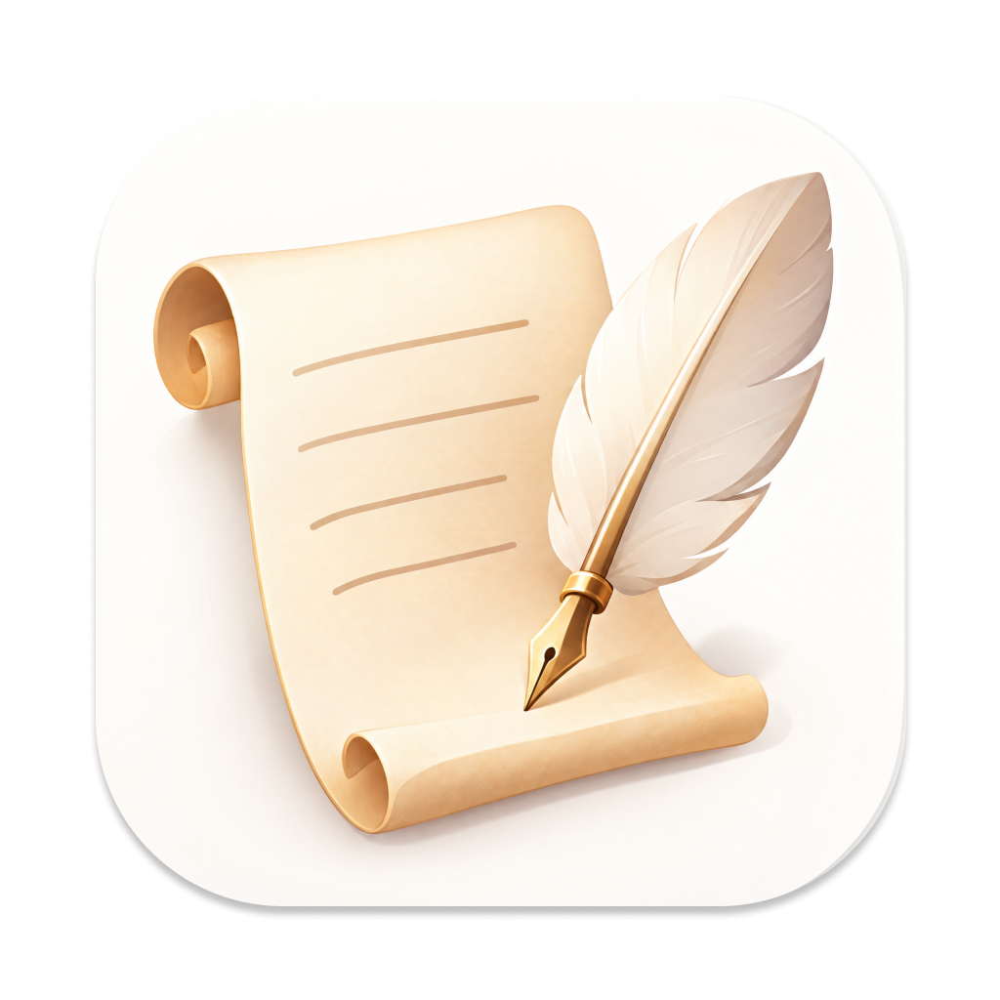
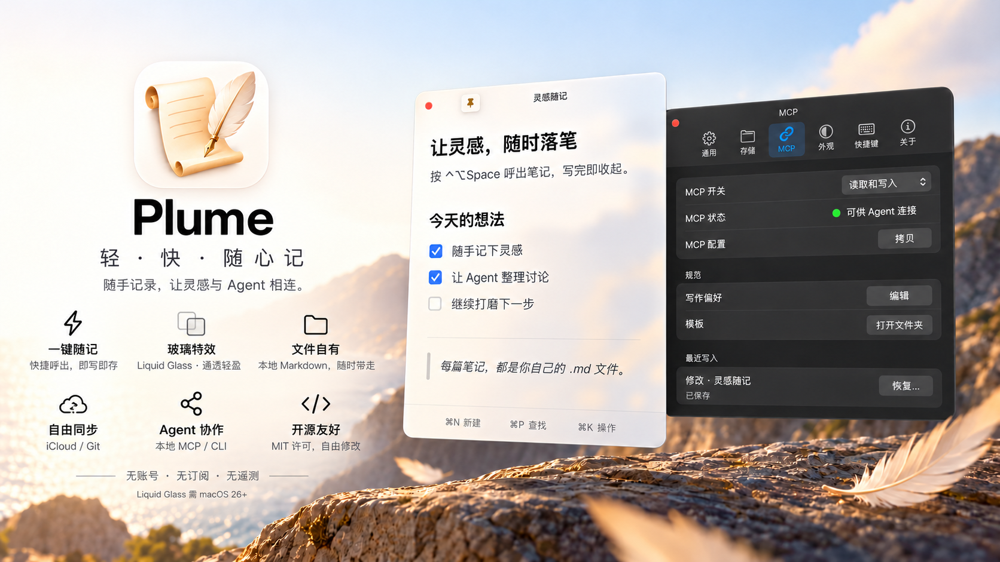

<p align="center">
  
</p>

<h1 align="center">Plume</h1>

<p align="center">
  A sheet of glass over whatever you're doing, that you can write on.
</p>

<p align="center">
  English · <a href="README.zh-CN.md">简体中文</a>
</p>

<p align="center">
  <a href="LICENSE"></a>
  
  
  <a href="https://github.com/tiylabs/plume/releases"></a>
</p>

<p align="center">
  
</p>

Press <kbd>⌃⌥Space</kbd> to bring a floating note over your current app, write, and dismiss it.
Unlimited notes, no account, no subscription.

## Install

```bash
brew install --cask tiylabs/tap/plume
```

Or download the `.dmg` from the [latest release](https://github.com/tiylabs/plume/releases/latest)
and drag `Plume.app` into `Applications`. Releases are signed and notarized by Apple.

## Features

- **Global hotkey.** Opens the last note, with the caret where you left it.
- **Live Markdown.** Block symbols stay hidden; inline ones show only under the caret.
- **One panel.** <kbd>⌘P</kbd> switches notes (fuzzy and full-text search), <kbd>⌘K</kbd> opens actions.
- **Plain files.** Notes are `.md` files in a folder you choose (`~/Documents/Plume` by default).
  External edits are picked up; conflicts are saved to a separate file, never overwritten.
- **Sync.** Pick iCloud Drive under Settings › Storage, any folder your own sync tool manages, or a
  Git repository. Git sync uses the `git` on your Mac and your own SSH keys or saved credentials; every
  5 minutes it merges in what changed on the remote and commits and pushes what changed here. When both
  sides edited a note, Git's conflict markers are left in it, a yellow dot appears on the menu bar icon,
  and syncing resumes once you remove them. A failed sync shows a red dot.
- **Themes.** A theme is a CSS file in `~/Library/Application Support/Plume/Themes`.
- **Connect your agent.** Turn it on under Settings › Agent and your own AI agent can search and read
  notes, and create or partly change them following your writing preferences and templates, through
  the `plume-agent` helper inside the app (a local MCP server or a command line). Off by default,
  read-only available, and every write is listed and can be restored.
- **Private.** No permissions requested, no telemetry. The only network calls are an update check
  against GitHub, which can be turned off in Settings, and Git sync, which is off until you set it up.
  Agents talk to Plume over a local Unix socket on your Mac; Plume adds no network requests for them,
  and what an agent does with what it reads is up to that agent.

<kbd>⌘,</kbd> opens Settings. They are stored in `settings.json`, which Plume re-reads live.

## Build from source

Needs the Command Line Tools; no Xcode project.

```bash
make test-all  # every test suite
make dev       # rebuild and launch the isolated build/Plume Dev.app
make build     # release build of build/Plume.app
```

## License

MIT. See [LICENSE](LICENSE) and [THIRD_PARTY_NOTICES.md](THIRD_PARTY_NOTICES.md).

Forked from [ColeMei/pane](https://github.com/ColeMei/pane) (MIT) at commit `526dda4` and
developed independently since. Not affiliated with or endorsed by Raycast Technologies or the
upstream project.
